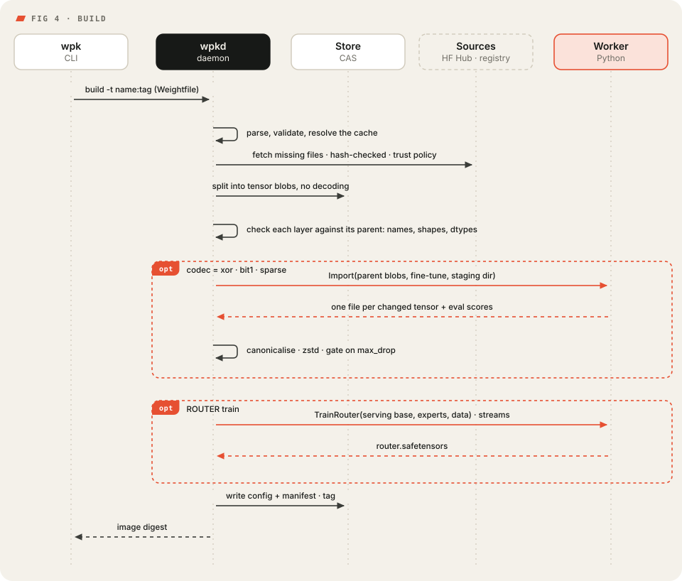
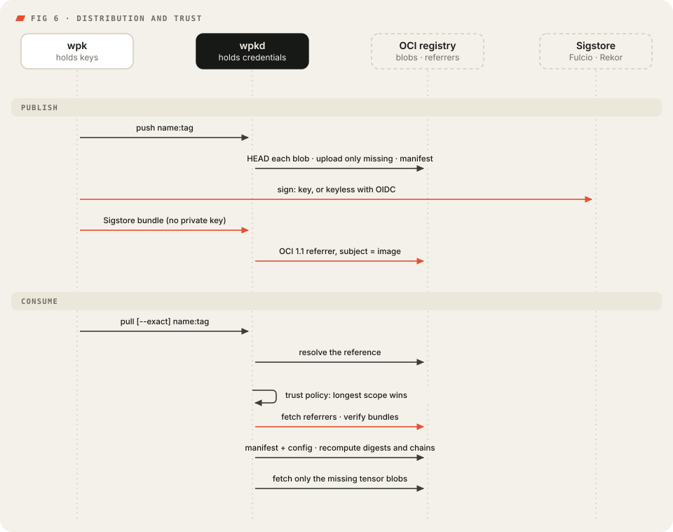
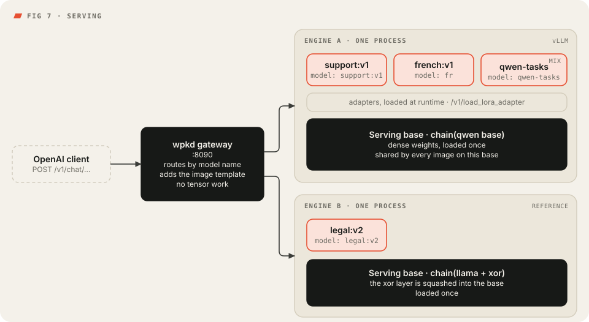
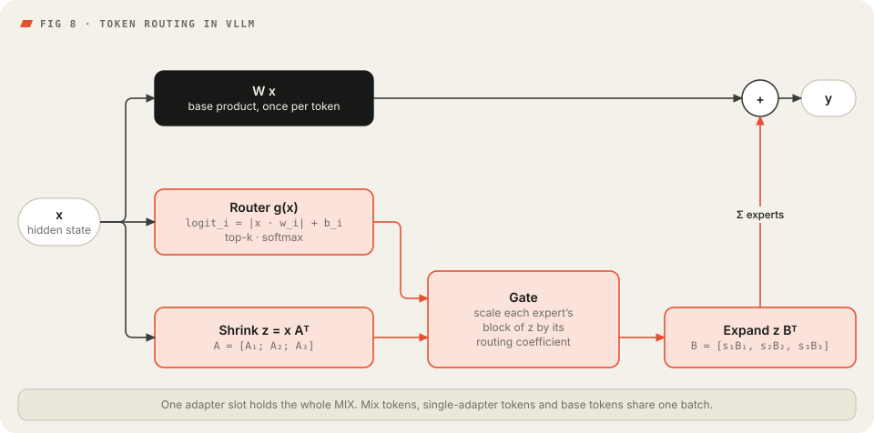

<p align="center">
  <picture>
    <source media="(prefers-color-scheme: dark)" srcset="assets/brand/weightpack-stacked-dark.svg">
    <source media="(prefers-color-scheme: light)" srcset="assets/brand/weightpack-stacked-light.svg">
    
  </picture>
</p>

<p align="center">
  <strong>Ship what changed.</strong><br>
  Package model weights as a shared base and reusable layers, and move them through any OCI registry.
</p>

<p align="center">
  <a href="docs/quickstart.md">Quickstart</a> ·
  <a href="docs/design.md">Design</a> ·
  <a href="docs/weightfile.md">Weightfile</a> ·
  <a href="docs/kubernetes.md">Kubernetes</a>
</p>

```bash
wpk build -t qwen-tasks .          # Weightfile -> image
wpk push ghcr.io/acme/qwen-tasks   # only the missing blobs
wpk run qwen-tasks                 # OpenAI-compatible endpoint
```

##  Why

Fine-tuned variants of one base model are usually stored, shipped and loaded as full copies. Weightpack stores each variant as only what it changed, and loads the base once per GPU.

| Base + 50 variants of an 8B model | Storage | Saving |
| --- | --- | --- |
| 51 full copies | 819 GB | 1× |
| Full fine-tunes as `xor` deltas (lossless) | about half | ~2× |
| Full fine-tunes as `bit1` deltas (eval-gated) | 66 GB | 12× |
| LoRA layers, rank 16 | 20 GB | 40× |

##  Concepts

| Term | Meaning |
| --- | --- |
| **Layer** | Weight changes over a parent (LoRA, XOR, 1-bit or sparse delta), pinned to the chain it was built on |
| **Stack** | Layers applied in order: W = W₀ + Δ₁ + Δ₂ + … |
| **Mix** | Layers side by side as experts; a router picks the top-k per token |
| **Squash** | A stack, or one expert of a mix, baked into dense weights |
| **Image** | A named composition of layers, stored as an OCI manifest |

A **Weightfile** declares an image:

```dockerfile
FROM hf://Qwen/Qwen2.5-0.5B-Instruct@7ae557604adf67be50417f59c2c2f167def9a775

# Stack: a LoRA trained on the base
LAYER support ./adapters/support

# Mix: experts trained on base + support, behind a router
MIX tasks top_k=1
  EXPERT python ./adapters/python
  EXPERT sql    oci://ghcr.io/acme/experts/sql:1.4
  EXPERT math   hf://acme/qwen2.5-0.5b-math-lora
  ROUTER train data=./mix.jsonl steps=600   # or: ROUTER arrow
```

A full fine-tune becomes a delta with `codec=xor` (lossless) or `codec=bit1|sparse max_drop=<n>` (eval-gated).

##  How it works

### Architecture

A thin CLI, one daemon per machine that owns the store, and an OCI registry in between. **Go works around the tensors, Python works on them:** `wpkd` moves, hashes and checks bytes; squash, codecs, evals and router training run in a Python worker over gRPC.

<picture>
  <source media="(prefers-color-scheme: dark)" srcset="assets/diagrams/architecture-dark.svg">
  
</picture>

### Image format

An image is a standard OCI manifest with one blob per tensor, so any registry stores it unchanged and identical tensors are stored once.

<picture>
  <source media="(prefers-color-scheme: dark)" srcset="assets/diagrams/image-format-dark.svg">
  
</picture>

- **Chain IDs** pin each layer to its parent, as Docker does. A layer on any other chain is refused.
- **Architecture fingerprint** (tensor names, shapes, dtypes, tokenizer) plays the role of `linux/amd64`.
- **Canonical blobs** make builds reproducible: the same inputs give the same manifest digest.

<picture>
  <source media="(prefers-color-scheme: dark)" srcset="assets/diagrams/chain-ids-dark.svg">
  
</picture>

### Build

`wpk build` resolves sources (`./path`, `hf://`, `oci://`), splits safetensors into tensor blobs without decoding them, checks every layer against its parent and caches each step.

<picture>
  <source media="(prefers-color-scheme: dark)" srcset="assets/diagrams/build-dark.svg">
  
</picture>

### Importing full fine-tunes

Full fine-tunes change every weight, so they are stored as deltas over their parent. Lossy codecs must pass an eval gate and carry a fidelity record; `wpk pull --exact` refuses them.

<picture>
  <source media="(prefers-color-scheme: dark)" srcset="assets/diagrams/import-dark.svg">
  
</picture>

### Distribution and trust

`push` and `pull` move only missing blobs. A pull checks signatures (cosign-compatible Sigstore), then every digest and chain ID, before it fetches a tensor.

<picture>
  <source media="(prefers-color-scheme: dark)" srcset="assets/diagrams/distribution-dark.svg">
  
</picture>

### Serving

`wpk run` serves an image on an OpenAI-compatible gateway. Images that share lower layers share one engine and one copy of the base; their top layers load as adapters at runtime.

<picture>
  <source media="(prefers-color-scheme: dark)" srcset="assets/diagrams/serving-dark.svg">
  
</picture>

| Hardware | Engine | Token routing |
| --- | --- | --- |
| NVIDIA GPU | vLLM, or the reference engine | `weightpack-vllm` plugin |
| Apple Silicon, CPU | Reference engine (transformers + PEFT) | Built in |

### Token routing

A MIX routes each token across its experts, on top of one shared base product:

$$y = W x + \sum_{i \in \mathrm{TopK}(g(x))} g_i(x)\, s_i B_i A_i x$$

<picture>
  <source media="(prefers-color-scheme: dark)" srcset="assets/diagrams/token-routing-dark.svg">
  
</picture>

- **Arrow** routes zero-shot from each expert's singular vectors.
- **`ROUTER train`** trains the router at build time with the experts frozen.

### Kubernetes

The Helm chart runs `wpkd` on every GPU node and `wpk-control` as one endpoint for the cluster. It places each model on a node already serving its base, so a new fine-tune loads only its adapters.

<picture>
  <source media="(prefers-color-scheme: dark)" srcset="assets/diagrams/kubernetes-dark.svg">
  
</picture>

##  What's shipped

Everything below is merged and tested, end to end on Qwen2.5-0.5B-Instruct (`npx nx run worker:smoke`).

| Area | Shipped | PR |
| --- | --- | --- |
| Build | Weightfiles, image format, `build` / `images` / `inspect` / `history` / `tag` / `validate` | [#1](https://github.com/rizkaitbrik/weightpack/pull/1) |
| Registries | `push` / `pull` of missing blobs only, verified before download, `--exact` | [#2](https://github.com/rizkaitbrik/weightpack/pull/2) |
| Squash | Dense weights, bit-exact with PEFT's merge | [#3](https://github.com/rizkaitbrik/weightpack/pull/3) |
| Export | Hugging Face + PEFT files and a Weightfile that rebuilds the same digest | [#4](https://github.com/rizkaitbrik/weightpack/pull/4) |
| Sources | `oci://` layers checked against their chain; pinned `hf://` repos | [#5](https://github.com/rizkaitbrik/weightpack/pull/5), [#8](https://github.com/rizkaitbrik/weightpack/pull/8) |
| Lossless import | Full fine-tunes as zstd XOR deltas | [#6](https://github.com/rizkaitbrik/weightpack/pull/6) |
| Lossy import | `bit1` and `sparse`, eval-gated, calibrated by distillation | [#18](https://github.com/rizkaitbrik/weightpack/pull/18), [#19](https://github.com/rizkaitbrik/weightpack/pull/19) |
| Store | Build cache, `rm`, `prune` | [#9](https://github.com/rizkaitbrik/weightpack/pull/9) |
| Serving | `run` / `ps` / `stop` / `logs`, shared bases, vLLM and the reference engine | [#10](https://github.com/rizkaitbrik/weightpack/pull/10) |
| Token routing | Arrow on the reference engine and inside vLLM; `ROUTER train` | [#15](https://github.com/rizkaitbrik/weightpack/pull/15), [#16](https://github.com/rizkaitbrik/weightpack/pull/16), [#17](https://github.com/rizkaitbrik/weightpack/pull/17) |
| Signing | `sign` / `verify` / `keygen` / `trust`, key and keyless Sigstore | [#13](https://github.com/rizkaitbrik/weightpack/pull/13) |
| Kubernetes | Helm chart and `wpk-control` with base-affinity placement | [#14](https://github.com/rizkaitbrik/weightpack/pull/14) |
| Tooling | `doctor`, `service install`, release archives, CPU and CUDA images, smoke test | [#7](https://github.com/rizkaitbrik/weightpack/pull/7), [#11](https://github.com/rizkaitbrik/weightpack/pull/11), [#12](https://github.com/rizkaitbrik/weightpack/pull/12) |

### Results

**Lossy import:** Qwen2.5-0.5B fully fine-tuned on GSM8K. Next-token accuracy; drop in points from the fine-tune.

| Layer | Size | GSM8K | Self suite |
| --- | --- | --- | --- |
| Fine-tune | 988 MB | 85.73 | 98.67 |
| `xor` | 429 MB | bit-exact | bit-exact |
| `bit1`, calibrated | 62 MB | 85.86 (−0.12) | 94.77 (3.89) |
| `sparse`, 10% | 72 MB | 85.78 (−0.05) | 90.28 (8.39) |

**Trained router:** three public LoRA experts, `top_k=1`. Loss per answer token; lower is better.

| Model | Python | SQL | Math | Mean |
| --- | --- | --- | --- | --- |
| Best single expert | 0.794 | 0.416 | 0.703 | 0.637 |
| Mix, Arrow | 0.794 | 0.510 | 0.692 | 0.665 |
| **Mix, trained router** | **0.726** | **0.147** | **0.579** | **0.484** |

Method and caveats are in the [design doc](docs/design.md).

##  Getting started

**Install** (macOS on Apple Silicon, Linux), then see the [quickstart](docs/quickstart.md):

```bash
curl -fsSL   https://raw.githubusercontent.com/rizkaitbrik/weightpack/main/scripts/install.sh | sh
wpk service install && wpk doctor
```

**Use:**

```bash
wpk build -t assistant ./project
wpk push --sign --key release.key ghcr.io/acme/assistant
wpk pull --exact ghcr.io/acme/assistant
wpk run assistant
curl http://127.0.0.1:8090/v1/chat/completions -H 'Content-Type: application/json' \
  -d '{"model":"assistant/legal","messages":[{"role":"user","content":"Hi"}]}'
```

**Develop** (Node.js 22+, Go 1.27+, Python 3.10+, [uv](https://docs.astral.sh/uv/)):

```bash
npm ci
npx nx run-many -t sync --projects=tag:lang:python
npx nx affected -t lint test build
```

##  Repository layout

| Path | What it is |
| --- | --- |
| `apps/wpk`, `apps/wpkd`, `apps/wpk-control` | CLI, daemon, cluster control plane (Go) |
| `libs/go/` | Format, store, builder, registry, trust, serving and control libraries |
| `python/worker` | Build worker and the reference engine |
| `python/vllm-plugin` | Token routing inside vLLM |
| `proto/` | gRPC contract between `wpkd` and the workers |
| `deploy/`, `docker/` | Helm chart, kind e2e test, container images |
| `docs/` | Quickstart, design, Weightfile reference, Kubernetes |

---

[Contributing](CONTRIBUTING.md) · [Issues](https://github.com/rizkaitbrik/weightpack/issues) · [Apache License 2.0](LICENSE)
