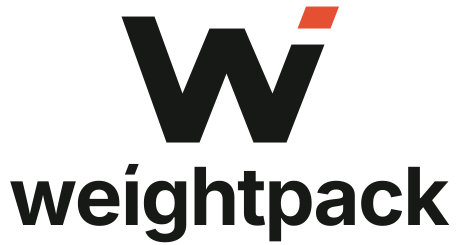
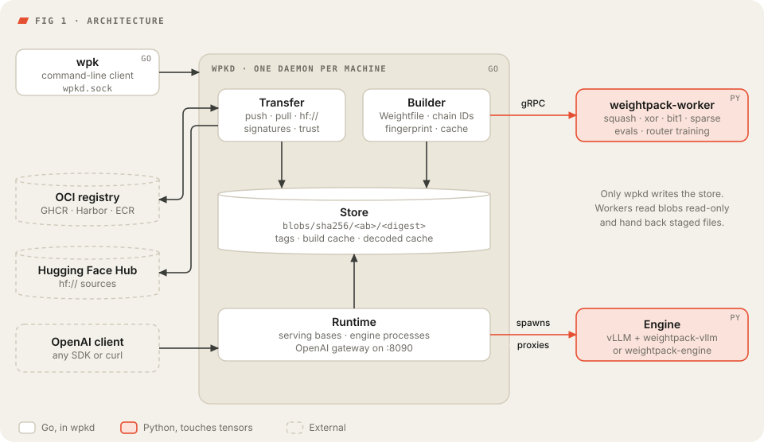
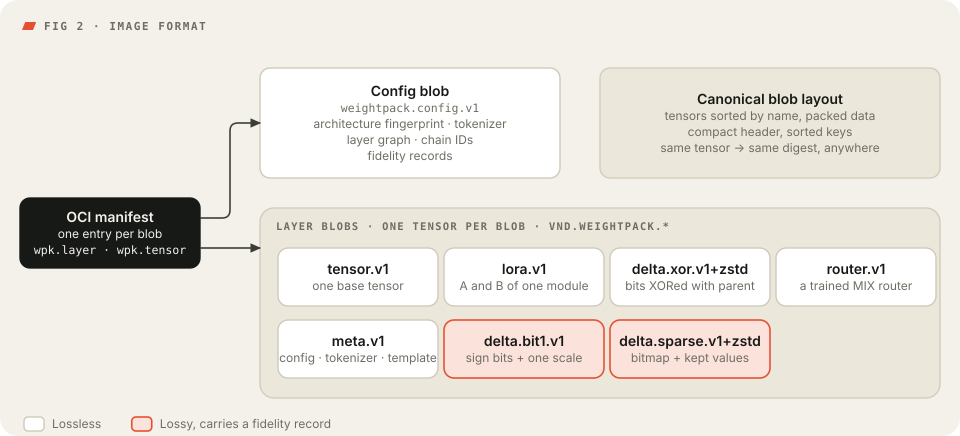
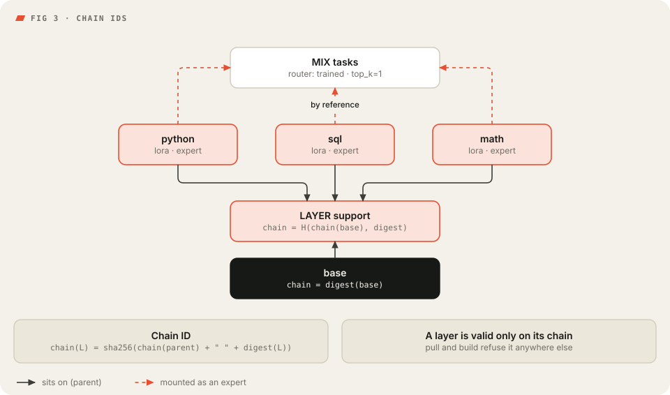
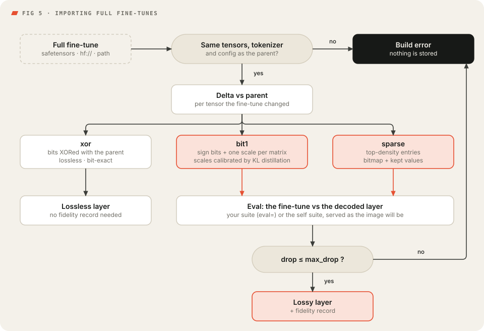
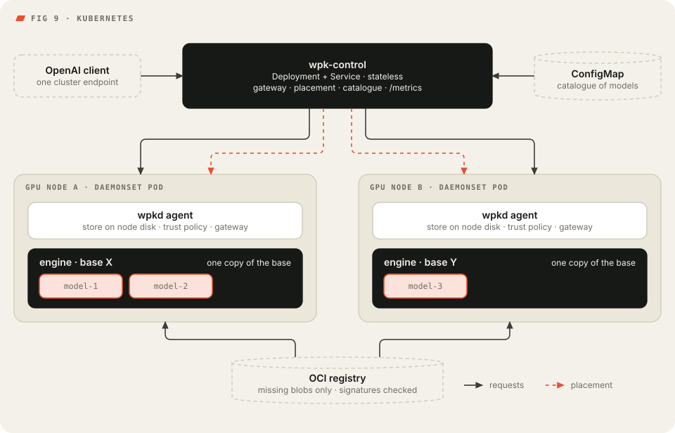

<p align="center">
  <picture>
    <source media="(prefers-color-scheme: dark)" srcset="assets/brand/weightpack-stacked-dark.svg">
    <source media="(prefers-color-scheme: light)" srcset="assets/brand/weightpack-stacked-light.svg">
    
  </picture>
</p>

**Docker for neural nets.** Weightpack ships a model as a base plus small, content-addressed weight layers. You can stack layers, or mix them side by side as experts behind a router, push the result to any OCI registry, and serve many images on one copy of the base behind a single OpenAI-compatible endpoint.

```bash
wpk build -t qwen-tasks .          # Weightfile -> image in the local store
wpk push ghcr.io/acme/qwen-tasks   # sends only the blobs the registry lacks
wpk run qwen-tasks                 # OpenAI endpoint; routes each token across the experts
```

- [Why](#why)
- [Concepts](#concepts)
- [How it works](#how-it-works): [architecture](#architecture), [image format](#image-format), [build](#build), [importing full fine-tunes](#importing-full-fine-tunes), [distribution and trust](#distribution-and-trust), [serving](#serving), [token routing](#token-routing), [Kubernetes](#kubernetes)
- [What has shipped](#what-has-shipped)
- [Measured results](#measured-results)
- [Getting started](#getting-started)
- [Repository layout](#repository-layout)

## Why

Teams end up with dozens of fine-tuned variants of one base model, and each one is stored, shipped and loaded as a full copy. Weightpack stores each variant as only what it changed, and loads the base once per GPU for every image built on it.

| Base + 50 variants of an 8B model (BF16) | Lossless | Storage | vs full copies |
| --- | --- | --- | --- |
| 51 full copies | Yes | 819 GB | 1× |
| Base + 50 full fine-tunes as `xor` deltas | Yes | about 2× smaller | about 2× |
| Base + 50 full fine-tunes as `bit1` deltas | No, eval-gated | 66 GB | 12× |
| Base + 50 LoRA layers, rank 16 | Yes | 20 GB | 40× |

## Concepts

| Term | Meaning | Docker analogue |
| --- | --- | --- |
| **Layer** | A set of weight changes over a parent: a LoRA adapter, an XOR delta, a 1-bit or sparse delta. Each layer is pinned to the exact chain it was built on. | Layer |
| **Stack** | Layers applied in order: W = W₀ + Δ₁ + Δ₂ + … | `FROM` + `RUN` |
| **Mix** | Layers side by side as experts. A router picks the top-k experts per token in each mixed module. | none |
| **Squash** | Bake a stack, or one expert of a mix, into plain dense weights. | `docker export` |
| **Image** | A named composition of layers, stored as an OCI manifest. | Image |
| **Container** | A running image: a model name on the OpenAI gateway. | Container |

A **Weightfile** declares an image, as a Dockerfile does:

```dockerfile
FROM hf://Qwen/Qwen2.5-0.5B-Instruct@7ae557604adf67be50417f59c2c2f167def9a775

# Stack: a LoRA adapter trained on the base
LAYER support ./adapters/support

# Mix: three adapters trained on base + support, behind a router
MIX tasks top_k=1
  EXPERT python ./adapters/python
  EXPERT sql    oci://ghcr.io/acme/experts/sql:1.4
  EXPERT math   hf://acme/qwen2.5-0.5b-math-lora
  ROUTER train data=./mix.jsonl steps=600      # or: ROUTER arrow (zero-shot)

TEMPLATE ./chat.jinja
LICENSE Apache-2.0
```

A full fine-tune comes in as a delta over its parent, losslessly or through an eval gate:

```dockerfile
FROM hf://Qwen/Qwen2.5-0.5B-Instruct
LAYER gsm8k ./finetunes/gsm8k codec=bit1 eval=./evals/gsm8k.yaml max_drop=1
```

The full syntax is in the [Weightfile reference](docs/weightfile.md).

## How it works

### Architecture

Weightpack is split the way Docker is: a thin CLI, one daemon per machine that owns the store, and a standard OCI registry between machines. One rule shapes the code: **Go works around the tensors, Python works on them.** The Go daemon moves bytes, hashes, checks and stores. Every per-weight operation (squash, delta codecs, evals, router training) runs in a Python worker over a local gRPC socket.

<picture>
  <source media="(prefers-color-scheme: dark)" srcset="assets/diagrams/architecture-dark.svg">
  
</picture>

| Component | Language | Owns |
| --- | --- | --- |
| `wpk` | Go | Parses commands and talks to the local `wpkd` |
| `wpkd` | Go | The store, the build cache, push and pull, signature checks, engine processes and the gateway |
| `weightpack-worker` | Python | Squash, XOR / bit1 / sparse codecs, evals, router training |
| `weightpack-engine` | Python | Reference engine: transformers + PEFT on CUDA, Metal or CPU, with token routing |
| `weightpack-vllm` | Python | vLLM plugin: serves a MIX as one adapter and routes each token inside vLLM |
| `wpk-control` | Go | Cluster control plane: gateway, base-affinity placement, catalogue, metrics |

Only the daemon ever writes to the store. It hands the worker read-only paths to the blobs it needs and a staging directory. When the worker is done, the daemon checks each output file (one tensor, the expected name, dtype and shape) and stores it in canonical form.

### Image format

An image is a standard OCI manifest, so any OCI registry stores it unchanged. Its blobs are tensors, one per blob, and its config declares the layer graph.

<picture>
  <source media="(prefers-color-scheme: dark)" srcset="assets/diagrams/image-format-dark.svg">
  
</picture>

Four rules make composition safe:

1. **Chain IDs.** A layer's identity is `sha256(parent chain ID + " " + layer digest)`, as Docker computes it. A layer is valid only on the exact chain it was built on, and the build refuses it anywhere else.
2. **Architecture fingerprint.** A hash over the base's sorted (tensor name, shape, dtype) list and its tokenizer, which plays the role of `linux/amd64`. Pull and build refuse a mismatch.
3. **Declared targets.** Every delta lists the tensors it touches, so untouched tensors cost nothing.
4. **One parent per mix.** Every expert in a `MIX` has the mix's parent chain.

<picture>
  <source media="(prefers-color-scheme: dark)" srcset="assets/diagrams/chain-ids-dark.svg">
  
</picture>

Tensor blobs use one canonical byte layout: tensors sorted by name, packed data, and a compact JSON header with sorted keys. The same tensor therefore has the same digest whatever file, shard or writer it came from. Dedup happens per tensor, and building the same inputs twice gives the same manifest digest. All the details are in the [design doc](docs/design.md#image-format).

### Build

`wpk build` resolves each source (a local path, `hf://`, or `oci://`), splits safetensors files into tensor blobs without decoding a value, checks every layer against its parent, and writes the image. Each step is cached on the identity of its inputs, so a rebuild of unchanged sources reads nothing.

<picture>
  <source media="(prefers-color-scheme: dark)" srcset="assets/diagrams/build-dark.svg">
  
</picture>

`wpk squash` follows the same pattern. The worker computes `W + Σ scalingᵢ · BᵢAᵢ` in float32 and rounds once, which matches PEFT's `merge_and_unload` bit for bit. The daemon stores only the tensors that changed. `wpk export` writes an image back out as a Hugging Face model directory, PEFT adapters, and a Weightfile that rebuilds the same manifest digest.

### Importing full fine-tunes

A full fine-tune changes every weight, so deduplication alone saves almost nothing. `wpk import` (or `codec=` on a layer) stores it as a delta over its parent instead.

<picture>
  <source media="(prefers-color-scheme: dark)" srcset="assets/diagrams/import-dark.svg">
  
</picture>

Every lossy layer carries a fidelity record with its source digest, codec, eval suite, both scores and the measured drop. `wpk history` shows it, and `wpk pull --exact` refuses any image that contains a lossy layer.

### Distribution and trust

`push` and `pull` speak the OCI distribution API with the credentials `docker login` stores, and move only the blobs the other side lacks. A pull checks signatures, then the manifest and config (every digest and chain ID recomputed), before it fetches a single tensor.

<picture>
  <source media="(prefers-color-scheme: dark)" srcset="assets/diagrams/distribution-dark.svg">
  
</picture>

Signatures use cosign v3's format, so `cosign verify` checks what `wpk` signs and the other way round. Private keys and identity tokens stay in `wpk` and never reach the daemon.

### Serving

`wpk run` serves an image on `wpkd`'s OpenAI-compatible gateway. Engines apply one adapter per request, so everything below an image's adapters is baked into a dense **serving base**, named by the chain ID of its top layer. Images that share lower layers share one serving base, one engine process, and one copy of the weights in GPU memory.

<picture>
  <source media="(prefers-color-scheme: dark)" srcset="assets/diagrams/serving-dark.svg">
  
</picture>

- The first container on a base starts an engine on a loopback port. Later containers on the same base add their adapters at runtime through `/v1/load_lora_adapter`. The engine stops with its last container.
- XOR and lossy layers, and every stacked LoRA layer except the top one, are squashed into the serving base. The top LoRA layer, or each expert of a MIX, is served as an adapter.
- `wpkd` picks the engine from the device it detects: vLLM on NVIDIA GPUs when it is installed, and the reference engine (transformers + PEFT) on CUDA, Apple Silicon (Metal) and CPU.

| Hardware | Default engine | Token routing |
| --- | --- | --- |
| NVIDIA GPU (`cuda`) | vLLM when it is installed, otherwise the reference engine | `weightpack-vllm` plugin |
| Apple Silicon GPU (`mps`) | Reference engine | Built in |
| CPU | Reference engine | Built in |

### Token routing

A MIX's own model name routes every token. In each LoRA module the mix covers, the base product is computed once, and the router adds the chosen experts' deltas:

$$y = W x + \sum_{i \in \mathrm{TopK}(g(x))} g_i(x)\, s_i B_i A_i x$$

<picture>
  <source media="(prefers-color-scheme: dark)" srcset="assets/diagrams/token-routing-dark.svg">
  
</picture>

- **Arrow router (zero-shot).** An expert's prototype in a module is the top right singular vector of its BA, computed exactly from the small factors when the mix loads. No training and no stored weights are needed.
- **Trained router.** `ROUTER train` starts from Arrow, adds a bias, and trains the router with the experts frozen on the language-modelling loss of the routed model. It uses a straight-through top-k and activation checkpointing, and stores the result as one `router.v1` blob.
- **Inside vLLM.** The plugin serves the MIX as one adapter whose rank blocks are the experts, and gates the shrink output per token between vLLM's two LoRA kernels. Mix tokens, single-adapter tokens and base tokens share one batch, and the routing buffers survive CUDA-graph capture.

### Kubernetes

The Helm chart runs `wpkd` on each GPU node as a DaemonSet, and `wpk-control` in front of them as one OpenAI endpoint for the cluster. The control plane is stateless. It discovers agents through a headless Service, reads a catalogue of models from a ConfigMap, and moves each model one step toward its replica count on every pass.

<picture>
  <source media="(prefers-color-scheme: dark)" srcset="assets/diagrams/kubernetes-dark.svg">
  
</picture>

**Base affinity is the placement rule.** A new replica goes, in order of preference, to a node whose engine already serves the image's serving base, then to a node that holds the image, then to one that holds its base layer, and otherwise to the least-loaded node. A new fine-tune of a running base therefore loads only its adapters. Before placing an image, the control plane has an agent resolve it under the trust policy, so it never places an image the nodes would refuse. See [docs/kubernetes.md](docs/kubernetes.md).

## What has shipped

Every feature below is merged on `main` and covered by tests. The end-to-end flow is checked on Qwen2.5-0.5B-Instruct with public LoRA adapters (`npx nx run worker:smoke`).

| Area | What you get | PR |
| --- | --- | --- |
| Format and build | Weightfile parser, image format, chain IDs, architecture fingerprint, `wpk build` / `images` / `inspect` / `history` / `tag` / `validate` | [#1](https://github.com/rizkaitbrik/weightpack/pull/1) |
| Distribution | `push` / `pull` to any OCI registry, moving only missing blobs and checking everything before any tensor is fetched; `pull --exact` | [#2](https://github.com/rizkaitbrik/weightpack/pull/2) |
| Squash | LoRA layers, or one expert of a mix, baked into dense weights, matching PEFT's merge bit for bit (plain and rsLoRA) | [#3](https://github.com/rizkaitbrik/weightpack/pull/3) |
| Export | Hugging Face base + PEFT adapters + a Weightfile that rebuilds the same digest | [#4](https://github.com/rizkaitbrik/weightpack/pull/4) |
| Registry sources | `FROM`, `LAYER` and `EXPERT` from images in registries, refused when built on another chain | [#5](https://github.com/rizkaitbrik/weightpack/pull/5) |
| Lossless import | `wpk import` and `codec=xor`: full fine-tunes stored as zstd XOR deltas, bit-exact | [#6](https://github.com/rizkaitbrik/weightpack/pull/6) |
| Real-model smoke test | The whole flow on a real model and real adapters | [#7](https://github.com/rizkaitbrik/weightpack/pull/7) |
| Hugging Face sources | `hf://` repositories pinned to commits and hash-checked; `modules_to_save` | [#8](https://github.com/rizkaitbrik/weightpack/pull/8) |
| Cache and GC | Build cache keyed on file identity, `wpk rm`, `wpk prune` | [#9](https://github.com/rizkaitbrik/weightpack/pull/9) |
| Serving | `wpk run` / `ps` / `stop` / `logs`, shared serving bases, the OpenAI gateway, vLLM and the reference engine on CUDA, Metal and CPU | [#10](https://github.com/rizkaitbrik/weightpack/pull/10) |
| Setup | `wpk doctor` with a fix for each failure; `wpk service install` (launchd, systemd) | [#11](https://github.com/rizkaitbrik/weightpack/pull/11) |
| Distribution of Weightpack | Release archives (macOS arm64, Linux amd64 and arm64), `install.sh`, CPU and CUDA container images | [#12](https://github.com/rizkaitbrik/weightpack/pull/12) |
| Signing | `wpk sign` / `verify` / `keygen` / `trust`, key and keyless Sigstore, cosign-compatible; enforced on pull and `FROM` | [#13](https://github.com/rizkaitbrik/weightpack/pull/13) |
| Kubernetes | Helm chart, `wpk-control` with base-affinity placement, catalogue, Prometheus metrics, kind e2e test | [#14](https://github.com/rizkaitbrik/weightpack/pull/14) |
| Token mixing | Per-token Arrow routing across a MIX's experts on the reference engine, checked against PEFT's Arrow | [#15](https://github.com/rizkaitbrik/weightpack/pull/15) |
| vLLM routing | The `weightpack-vllm` plugin: per-token routing inside vLLM, CUDA-graph safe | [#16](https://github.com/rizkaitbrik/weightpack/pull/16) |
| Router training | `ROUTER train`: routers trained at build time, cached, stored as `router.v1`, served by both engines | [#17](https://github.com/rizkaitbrik/weightpack/pull/17) |
| Lossy import | `codec=bit1` and `codec=sparse`, eval-gated on `max_drop`, with fidelity records | [#18](https://github.com/rizkaitbrik/weightpack/pull/18) |
| bit1 calibration | bit1 scales calibrated by KL distillation against the fine-tune, as BitDelta does | [#19](https://github.com/rizkaitbrik/weightpack/pull/19) |

## Measured results

**Lossy import** (`npx nx run worker:import-gate`). Qwen2.5-0.5B-Instruct, fully fine-tuned on GSM8K, imported over the base on one A40. Scores are next-token accuracy; the drop is in points against the fine-tune.

| Layer | Stored, of 988 MB changed | GSM8K: score (drop) | Self suite: score (drop) |
| --- | --- | --- | --- |
| The fine-tune | 988 MB | 85.73 | 98.67 |
| `xor` | 429.3 MB (43.4%) | bit for bit | bit for bit |
| `bit1`, calibrated | 62.0 MB (6.3%) | 85.86 (−0.12) | 94.77 (3.89) |
| `sparse`, density 0.1 | 72.1 MB (7.3%) | 85.78 (−0.05) | 90.28 (8.39) |
| The base alone | none | 81.50 (4.23) | 83.55 (15.12) |

**Trained router** (`npx nx run worker:gate`). The same base with three public LoRA experts, mixed in every projection at `top_k=1`. The router was trained for 600 steps on 1,200 examples (5 minutes on one A40). Mean loss per answer token on 50 held-out examples per domain, lower is better:

| Model | Python | SQL | Math | Mean |
| --- | --- | --- | --- | --- |
| base | 0.847 | 0.526 | 0.860 | 0.744 |
| best single expert (math) | 0.794 | 0.416 | 0.703 | 0.637 |
| mix, Arrow | 0.794 | 0.510 | 0.692 | 0.665 |
| **mix, trained router** | **0.726** | **0.147** | **0.579** | **0.484** |

The trained mix beats every single expert on every domain, and beats Arrow by 27% on the mean. The eval is in-distribution: the router was trained on other examples from the same three datasets. The [design doc](docs/design.md) gives the full method and caveats.

## Getting started

### Use it

Follow the [quickstart](docs/quickstart.md): install, check the machine, build a mix of fine-tunes from the Hugging Face Hub and serve it.

```bash
curl -fsSL https://raw.githubusercontent.com/rizkaitbrik/weightpack/main/scripts/install.sh | sh
wpk service install && wpk doctor
```

The container images `ghcr.io/rizkaitbrik/weightpack:cpu` and `:cuda` bundle the daemon, the worker and an engine.

```bash
wpk build -t assistant:v1 ./project                       # Weightfile -> image
wpk history assistant:v1                                  # layers, chains, codecs, fidelity
wpk import --parent ./base -t finance ./finance-finetune  # full fine-tune as XOR deltas
wpk squash -t assistant-legal --expert legal assistant:v1 # dense weights, one expert baked in
wpk export -o ./out assistant-legal                       # HF + PEFT files and a Weightfile

wpk keygen -o release
wpk push --sign --key release.key registry.example.com/team/assistant:v1
wpk trust set registry.example.com/team --key release.pub
wpk pull --exact registry.example.com/team/assistant:v1   # refuses lossy layers

wpk run assistant:v1                                      # model assistant:v1 routes per token
curl http://127.0.0.1:8090/v1/chat/completions -H 'Content-Type: application/json' \
  -d '{"model": "assistant:v1/legal", "messages": [{"role": "user", "content": "Hi"}]}'
wpk ps && wpk logs -f assistant:v1 && wpk stop assistant:v1
wpk rm assistant-legal && wpk prune                       # untag, then delete unreachable blobs
```

`wpk` finds the daemon at `$WPK_SOCKET`, then `$WPK_ROOT/wpkd.sock`, then `~/.weightpack/wpkd.sock`. If the gateway listens beyond loopback (`wpkd --gateway 0.0.0.0:8090`), set `--gateway-key`. On Kubernetes:

```bash
helm install weightpack deploy/helm/weightpack -n weightpack --create-namespace \
  --set 'catalogue.models[0].name=qwen-tasks' --set 'catalogue.models[0].image=ghcr.io/acme/qwen-tasks:v1'
```

### Work on it

Requirements: Node.js 22+, Go 1.27+, Python 3.10+ and [uv](https://docs.astral.sh/uv/). Read [AGENTS.md](AGENTS.md) and [CONTRIBUTING.md](CONTRIBUTING.md) first.

```bash
git clone https://github.com/rizkaitbrik/weightpack && cd weightpack
npm ci
npx nx run-many -t sync --projects=tag:lang:python   # create the Python venvs
npx nx run-many -t lint test build                   # everything
npx nx affected -t lint test build                   # what your change touches
npx nx test store                                    # one project

npx nx run-many -t build --projects=wpk,wpkd
./dist/apps/wpkd --worker "uv run --project python/worker weightpack-worker" \
  --engine-reference "uv run --project python/worker --extra serve weightpack-engine" &
./dist/apps/wpk doctor
```

## Repository layout

This is an [Nx](https://nx.dev) workspace with one Go module at the root and one `uv` project per Python package.

| Path | Language | What it is |
| --- | --- | --- |
| `apps/wpk` | Go | Command-line client |
| `apps/wpkd` | Go | Daemon: store, build cache, push and pull, engines and the OpenAI gateway |
| `apps/wpk-control`, `libs/go/control` | Go | Cluster control plane |
| `libs/go/spec` | Go | Image format: media types, config schema, layer digests, chain IDs, fingerprint |
| `libs/go/store` | Go | Content-addressed blob store, tags and prune |
| `libs/go/weightfile` | Go | Weightfile parser |
| `libs/go/build` | Go | Builder: sources, base splitting, LoRA checks, XOR / lossy import, router training, cache |
| `libs/go/safetensors` | Go | safetensors header reader and canonical writer; never decodes values |
| `libs/go/reference`, `libs/go/registry`, `libs/go/hf` | Go | OCI references, registry push and pull, Hugging Face Hub client |
| `libs/go/trust` | Go | Sigstore signing and verification, trust policy |
| `libs/go/squash`, `libs/go/export` | Go | Squash and export orchestration |
| `libs/go/serving` | Go | Runtime: serving bases, engine processes, gateway, device checks |
| `libs/go/daemon`, `libs/go/api` | Go | `wpkd`'s HTTP API and its client |
| `libs/go/entropy` | Go | Entropy coders named by media-type suffix (`+zstd`) |
| `libs/go/service` | Go | `wpk service`: launchd and systemd units |
| `libs/go/worker`, `libs/go/workerpb`, `proto/` | Go, Protobuf | gRPC contract and client for the Python worker |
| `python/worker` | Python | Build worker and `weightpack-engine`, the reference engine |
| `python/vllm-plugin` | Python | `weightpack-vllm`: token routing inside vLLM |
| `deploy/helm/weightpack`, `deploy/kind` | Helm, Shell | Kubernetes chart and kind e2e test |
| `docker/`, `.goreleaser.yaml`, `scripts/` | | Container images, release archives, `install.sh` |
| `docs/` | | [Quickstart](docs/quickstart.md), [design](docs/design.md), [Weightfile reference](docs/weightfile.md), [Kubernetes](docs/kubernetes.md) |

## Contributing

Contributions are welcome. Start with [CONTRIBUTING.md](CONTRIBUTING.md), and open an issue before large changes so the design can be agreed first. Ideas for improvements live in [GitHub issues](https://github.com/rizkaitbrik/weightpack/issues).

## License

[Apache License 2.0](LICENSE)
