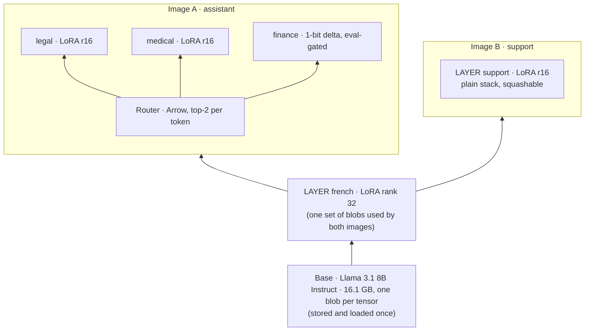
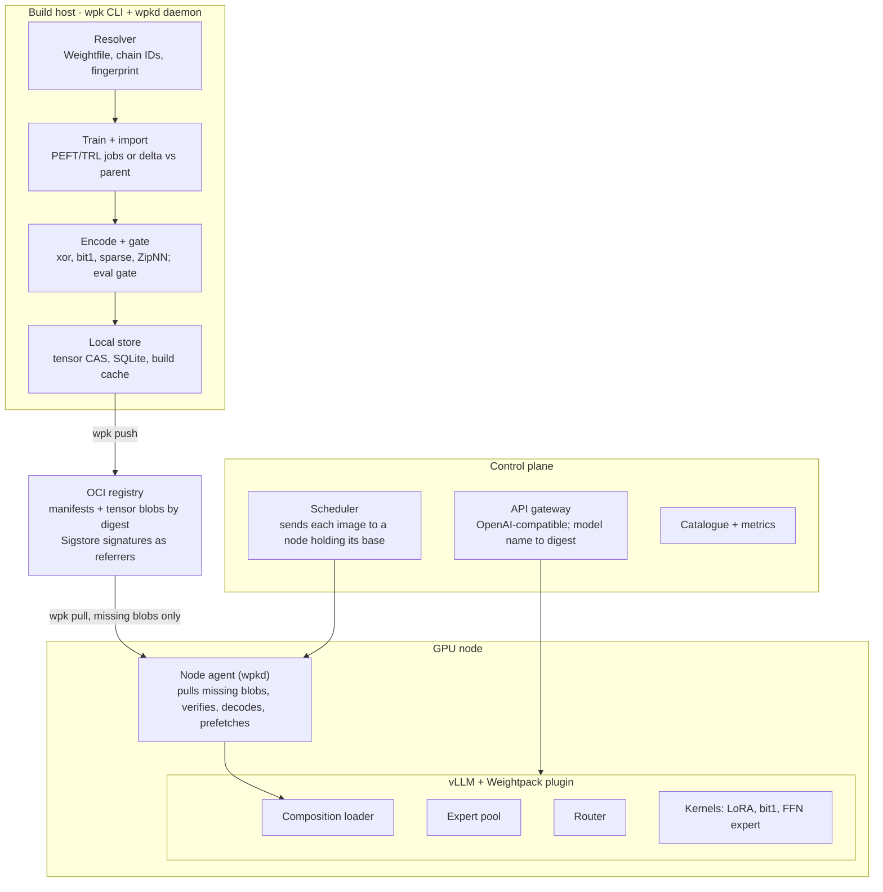

# Weightpack — Docker for neural nets

Status: draft · Last updated 2026-11-24

## Summary

Weightpack is Docker for model weights. A model ships as a base plus content-addressed delta layers, is built from a Weightfile, and is pushed to any OCI registry. It adds one thing Docker lacks: layers can sit side by side as experts behind a router, which gives you a mixture-of-experts without copying the base. A base 8B model plus 50 LoRA variants takes about 20 GB, against about 820 GB as full copies.

It has three parts:

1. **Format.** An OCI artifact with one blob per tensor. Each layer pins its parent chain and the base's architecture fingerprint.
2. **Composition.** A Weightfile with `FROM`, `LAYER` (stack), `MIX` / `EXPERT` / `ROUTER` (mix), plus `wpk squash` to bake the result into dense weights.
3. **Store and runtime.** On disk: tensor-level dedup plus delta codecs. At serve time: the base loads once, expert deltas page in, and a router picks them per request, sequence or token.

The main design decision is to make adapter-style layers (LoRA and similar) the native unit. Full fine-tunes change every weight, so dedup alone saves little on them. They come in through an import step that stores a compressed delta and records how much quality it lost.

## Problem and scope

Teams end up with dozens of variants of one base model: per domain, per client, per language. Each is stored, shipped and loaded as a full copy. Combining two of them (legal and French, say) means retraining or a lossy weight merge.

**Terms.** In this doc a *layer* is a Docker-style layer: a set of weight changes over a parent. A transformer layer is called a *block*. An *expert* is a layer mounted in a mix behind a router. An *image* is a named composition of layers, and a *container* is a running instance of one.

**Goals**

- **G1. Store only what changed.** Each variant costs its delta. Push and pull move only blobs the other side lacks.
- **G2. Compose independently built layers.** Stack them or mix them, declared in a file and reproducible by digest.
- **G3. Serve many compositions at once.** The base sits in GPU memory once, shared by every container on that GPU.
- **G4. Reuse existing infrastructure.** OCI registries, signing, safetensors, the Hugging Face Hub, existing inference engines.
- **G5. Make every lossy step visible.** Each lossy layer records its codec and its measured quality drop. Exact pulls can refuse it.

**Non-goals**

- Mixing models of different architectures or tokenizers. All layers in an image descend from one base.
- Training. Weightpack calls existing trainers (PEFT, TRL, Axolotl) and caches their output; it does not replace them.
- Guaranteeing that any combination is good. The build checks compatibility; quality is measured by eval hooks.

## Prior art and the gap

Each piece of this exists today. What is missing is one system where a layer is a typed delta with a pinned parent, layers can be stacked or mixed, and a mix is served without first being turned into a full checkpoint. Weightpack is mostly integration; the least mature piece is token-level routing over deltas inside a production engine.

| Project | What it already does | What it lacks here | What Weightpack takes |
| --- | --- | --- | --- |
| [Ollama Modelfile](https://docs.ollama.com/modelfile) and [manifest](https://pkg.go.dev/github.com/ollama/ollama@v0.12.0/server/internal/manifest) | `FROM` + `ADAPTER`; content-addressed blobs; tensors stored as manifest layers | No mixing; an adapter on the wrong base is undefined behaviour, not a build error | Build-file UX, per-tensor blobs |
| [CNCF ModelPack](https://github.com/modelpack/model-spec), [Docker Model Runner](https://docs.docker.com/reference/cli/docker/model/package/) | OCI artifact spec for models; Docker can emit ModelPack format | Weight layers are whole files, not deltas over a parent; no composition | The envelope. Weightpack should be a ModelPack extension, not a rival |
| [Hugging Face Xet](https://huggingface.co/docs/hub/xet/index.md) | Chunk-level dedup (about 64 KB chunks); only changed chunks move | Byte-level, not tensor-aware; a full fine-tune changes almost every chunk | Optional storage backend |
| [ZipLLM](https://arxiv.org/abs/2505.06252) (NSDI '26) | Tensor-level dedup plus lossless XOR delta (BitX); 54% less storage | Storage only; no composition or serving | Lossless delta tier |
| [ZipNN](https://arxiv.org/abs/2411.05239) | Lossless; compresses float exponents apart; BF16 Llama 3.1 shrinks to 66.4% | Single-model, no deltas | Entropy-coding stage |
| [BitDelta](https://arxiv.org/abs/2402.10193) | Fine-tune delta stored as 1 sign bit per weight plus a scale per matrix | Lossy; needs a calibration pass | Lossy tier for full fine-tunes |
| [S-LoRA](https://arxiv.org/abs/2311.03285) | Thousands of LoRAs on one GPU: unified paging, batched kernels | One adapter per request; no packaging | Runtime memory design |
| [BTX](https://arxiv.org/abs/2403.07816), [mergekit-moe](https://huggingface.co/blog/mlabonne/frankenmoe), [MixtureKit](https://arxiv.org/abs/2512.12121) | Build an MoE from dense fine-tunes: their FFNs become experts, the rest is averaged or taken from a base | Output is one monolithic checkpoint; nothing deduplicated | "FFN expert" layer kind, router init |
| [Arrow](https://arxiv.org/abs/2405.11157) (ICML 2024, now in PEFT) | Zero-shot routing over a LoRA library, from each LoRA's SVD; no router training | Research-grade; no packaging | Default router for independently built layers |

## Core model: stack, mix, squash

Layers combine in three ways: stacked on top of each other (the only mode Docker has), mixed side by side behind a router, or squashed into plain weights.



Image B pulls nothing new except its top layer, because the base and `french` blobs are already local. In image A the router sends each token to two of the three experts.

| Layer kind | Holds | Size for an 8B base |
| --- | --- | --- |
| `base` | Every tensor of a released model | 16.1 GB in BF16 |
| `lora` | A and B matrices for its target modules | 84 MB at rank 16, all modules |
| `delta` | An encoded difference over full-shape tensors (`xor`, `bit1`, `sparse`) | About 1 GB at 1 bit per weight |
| `ffn-expert` | A replacement FFN per block, BTX-style, stored as a delta over the base FFN | Depends on the codec |
| `mix` | Its experts by reference, and a trained router's weights in one `router.v1` blob (an Arrow mix holds none) | One vector and a bias per expert per routed module |
| `meta` | Tokenizer, chat template, license, model card | Kilobytes |

**Stack.** Deltas add up in the order of the chain:

$$W = W_0 + \Delta_1 + \Delta_2 + \dots$$

Each delta was trained on everything below it, so the chain IDs fix the order.

**Mix.** In each targeted module of the chosen blocks, the router g picks the top k experts per token:

$$y = W x + \sum_{i \in \mathrm{TopK}(g(x))} g_i(x)\, \Delta_i x$$

The base stays on for every token and acts as a shared expert. The routed experts are deltas, not copies of the FFN, which is why a mix of three experts costs little more than the base.

**Squash.** Bake a stack, or a mix with fixed weights, into one delta or into dense weights. A mix with per-token routing cannot be squashed: the routing is what makes it a mixture of experts.

`wpk squash` bakes a stack of LoRA layers, or a stack plus one chosen expert of a mix (`--expert`), into dense weights and stores the result as a new image with a single `base` layer. For every base tensor a layer modifies it computes `W + Σ scalingᵢ · (Bᵢ Aᵢ)` in float32, layers in chain order, and rounds once, to nearest even, to the tensor's dtype. That is what PEFT's `merge_and_unload` does for a float32 adapter, and the parity test (`npx nx run worker:parity`) checks it bit for bit on a BF16 Llama, for plain and rsLoRA scaling. Tensors no layer touches keep their blobs, so a squash stores only what it changed, and the tensor table, and so the architecture fingerprint, is the base's. The manifest records what was baked: `wpk.squashed` lists the layer ids, bottom first, and `wpk.squashed.from` holds the source image's manifest digest.

## System architecture

Weightpack splits into three planes, as Docker does: a build host that turns a Weightfile into blobs, a standard OCI registry that stores them, and GPU nodes that serve images through vLLM with a Weightpack plugin. A small control plane routes requests and places each image on a node where its base is already loaded.



Blobs reach a node only through the registry, and only the ones it lacks. Requests reach the engine only through the gateway, after the scheduler has picked a node.

| Component | Runs on | Language | Owns |
| --- | --- | --- | --- |
| `wpk` CLI | Laptop, CI | Go | Parses commands; talks to the local `wpkd` |
| `wpkd` daemon | Build hosts and GPU nodes | Go | Local store, build cache, push and pull, signature checks |
| Build workers | Build hosts with GPUs | Python | Training (PEFT, TRL), delta import, codecs, eval runs |
| Weightpack plugin | Inside each vLLM process | Python, Triton, CUDA | Composition loading, expert pool, routers, kernels |
| Control plane (`wpk-control`) | Kubernetes, as a Deployment (Helm chart) | Go | Gateway, scheduler, catalogue, metrics |
| OCI registry | Existing: Harbor, GHCR, ECR | n/a | Manifests, blobs, signatures |

**Design decisions**

- **One daemon per machine, as with dockerd.** The CLI stays thin. `wpkd` owns the store, so concurrent builds and pulls share one CAS and one cache. On a GPU node the same daemon is the node agent.
- **Go around the tensors, Python on them.** OCI, Kubernetes and Sigstore libraries are Go-first; PEFT, vLLM and eval harnesses are Python. The two talk over a local gRPC socket (`proto/weightpack/worker/v1`). Per-weight work (squash, codecs, hashing large tensors) stays in Python on native libraries, never in the daemon. The daemon hands the worker the paths of the blobs it needs, which the worker opens read-only, and a staging directory for its output; it then checks each output file (one tensor, the expected name, dtype and shape) and stores it in canonical form itself, so only the daemon ever writes to the store. Splitting a safetensors file into tensor blobs is not per-weight work: the daemon copies the byte ranges the header names and never decodes a value, and the store hashes blobs as it writes them, as any OCI store does.
- **Store layout.** Blobs sit under `blobs/sha256/<ab>/<digest>`, compressed as pushed. Beside them is a decoded cache of memory-mappable safetensors, and SQLite holds images, chain IDs, reference counts and fidelity records. The decoded cache is disposable. Until reference counts and fidelity records arrive, tags live in an `index.json` in the OCI image-layout format, one manifest descriptor per `name:tag`.
- **Base affinity is the scheduling rule.** The scheduler groups images by base digest and sends each request to a replica that already holds that base. Cluster-level memory savings come from this rule, not from the format. A new copy of a base loads only when no replica holding it has room.
- **The control plane is stateless.** `wpk-control` finds the agents through a headless Service's DNS name, so it needs no Kubernetes API access, and every few seconds reads each agent (`wpkd --api`: its node, engines, containers and stored images) and a catalogue of images to serve from a ConfigMap. It moves each model one step toward its replicas per pass: add a replica on the best node (one whose engine serves the image's serving base, then one holding the image, then one holding its base layer, then the least loaded), replace one that runs an old digest, or stop one too many. It manages only the containers it started (`RunRequest.Owner`). Before placing, it has an agent resolve the image under its trust policy, so an image the nodes would refuse is never placed. Requests go to the replica with the fewest in flight; a model with no replica starts on its first request. Agents cap their engines (`--max-engines`), since vLLM claims most of a GPU. The chart and its operation are in [kubernetes.md](kubernetes.md).
- **The engine stays stock.** The plugin uses vLLM's plugin and LoRA interfaces plus one custom module for mixes, so a vLLM upgrade does not mean maintaining a fork.
- **Nodes are disposable.** Everything a node needs is addressable by digest, so a node can be drained, rebuilt and refilled from the registry.
- **Trust boundary at pull.** `wpkd` checks an image's signatures against its trust policy once the reference resolves, before it fetches the config or any tensor (see Signatures). The plugin loads only safetensors from the decoded cache. Training jobs run sandboxed, without registry credentials.

## Image format

An image is a standard OCI manifest. Its blobs are tensors and its config declares the layer graph, so any OCI registry (Docker Hub, GHCR, Harbor, ECR) stores it unchanged.

- **Manifest `layers[]`:** one entry per tensor blob, annotated with its layer id and tensor name. Small tensors (norms, biases) are packed into one blob per layer. Identical tensors across images get the same digest, so they are stored once.
- **Config blob:** the architecture fingerprint, the tokenizer digest, the layer graph and the fidelity records.

```json
{
  "schema": "weightpack.config.v1",
  "arch": { "family": "llama", "fingerprint": "sha256:9f1c…", "blocks": 32, "hidden": 4096 },
  "tokenizer": "sha256:44ab…",
  "layers": [
    { "id": "base",    "kind": "base", "digest": "sha256:d203…", "chain": "sha256:d203…" },
    { "id": "french",  "kind": "lora", "parent": "base", "digest": "sha256:7e01…", "chain": "sha256:cbb5…",
      "rank": 32, "alpha": 64, "targets": ["q", "k", "v", "o", "gate", "up", "down"] },
    { "id": "domain",  "kind": "mix", "parent": "french", "blocks": "8-31",
      "targets": ["gate", "up", "down"], "top_k": 2, "router": "arrow",
      "experts": ["legal", "medical", "finance"] },
    { "id": "legal",   "kind": "lora", "parent": "french", "rank": 16 },
    { "id": "medical", "kind": "lora", "parent": "french", "rank": 16 },
    { "id": "finance", "kind": "delta.bit1", "parent": "french",
      "fidelity": { "source": "hf://acme/llama-fin@3e2a…", "eval": "finance-v2", "max_drop": 0.5 } }
  ]
}
```

A build sets `digest` and `chain` on every layer (the other layers are abbreviated above). A LoRA layer's `alpha` and `rslora` give its scaling as PEFT defines it: alpha / rank, or alpha / √rank with `rslora: true`.

Four rules make composition safe:

1. **Chain IDs.** A layer's identity is `sha256(parent chain ID + " " + layer digest)`, as Docker computes it; the base's chain ID is its own digest. A layer is valid only on the exact chain it was built on. The **layer digest** is sha256 over the compact JSON of the layer's kind, the parameters that change how it applies (`rank`, `alpha`, `rslora`, `targets`, `blocks`, `top_k`, `router`), the layer digests of its experts in mix order (for a mix), and its blobs (tensor, title, media type, digest), sorted. The layer id is left out, so the same content under another name is the same layer, and so is the fidelity record, which says how a layer was made rather than what it is. Any reader can recompute every digest and chain ID from the manifest and config, which is how a pulled image is checked.
2. **Architecture fingerprint.** A hash over the base's sorted (tensor name, shape, dtype) list plus the tokenizer digest: the digest of the `tokenizer.json` blob, or of `tokenizer.model` when there is no `tokenizer.json`. It plays the role of `linux/amd64`: pull and build refuse a mismatch.
3. **Declared targets.** Every delta lists the tensors it touches. Untouched tensors cost nothing.
4. **One parent per mix.** All experts in a `MIX` must have the mix's parent chain.

Layer ids are lowercase letters, digits, `.`, `_` and `-`, starting with a letter or digit, at most 64 characters: the same form a Weightfile accepts. Configs with other ids are refused wherever an image is checked, at pull included, so an image from a registry cannot slip path syntax into an id that ends up naming a file or directory.

| Media type (`application/vnd.weightpack.…`) | Holds | Lossless |
| --- | --- | --- |
| `tensor.v1` | One base tensor, raw safetensors | Yes |
| `lora.v1` | A and B matrices for one target module | Yes |
| `delta.xor.v1` | Bitwise XOR against the parent tensor | Yes |
| `delta.bit1.v1` | One tensor's delta: sign bits plus one scale for a matrix | No |
| `delta.sparse.v1` | One tensor's delta: a bitmap of a matrix's kept entries and their values; stored `+zstd` | No |
| `router.v1` | A trained MIX router: per routed module, a weight row and a bias per expert | Yes |
| `meta.v1` | Tokenizer, chat template, license, model card | Yes |

An entropy coder is a suffix, as OCI does with `+zstd`: `lora.v1+zipnn`. Docker keeps model layers uncompressed so they can be memory-mapped; Weightpack trades that for size and decodes once into a local cache on pull. The daemon does the entropy coding, which is byte-level like hashing: it compresses what it stores and decompresses what it hands a worker, so workers only ever see plain safetensors. Compression runs with one encoder goroutine at a fixed level, so the same tensor gives the same blob digest with a given encoder version.

**Blob layout.** Tensor blobs are safetensors files in one canonical byte layout: tensors ordered by name, data packed with no gaps, a compact JSON header with sorted keys and no `__metadata__`, padded with spaces to a multiple of 8 bytes. The same tensors under the same names therefore give the same digest whatever file, shard or writer they came from, which is what makes tensor-level dedup work.

- `tensor.v1`: one base tensor, annotated `wpk.tensor` with its name. Tensors under 64 KiB (norms, biases) share one packed blob per layer, which has no `wpk.tensor` annotation; their names are in its header.
- `lora.v1`: the `lora_A` and `lora_B` matrices of one module, named in the base's naming (`model.layers.0.self_attn.q_proj.lora_A.weight`, without PEFT's `base_model.model.` prefix), annotated `wpk.tensor` with the base weight they modify. A LoRA layer may also hold `tensor.v1` blobs: `modules_to_save` copies, each a full tensor that replaces the base tensor of the same name (annotated `wpk.tensor` with it) at that layer's place in the chain, before the layer's LoRA deltas.
- `meta.v1`: one file per blob, named by the standard `org.opencontainers.image.title` annotation. The base's `config.json`, tokenizer files, license and model card belong to the base layer. A `TEMPLATE` file and a `LICENSE` file are image-level: they carry no `wpk.layer` annotation. A `LICENSE` given as an SPDX id becomes the manifest's `org.opencontainers.image.licenses` annotation instead.

Nothing in a manifest depends on paths, file order or time, so building the same inputs twice gives the same manifest digest.

### Signatures

Weightpack signs images the way cosign v3 signs container images, so `cosign verify` checks what `wpk` signs and `wpk` checks what cosign signs. A signature signs the manifest digest; the manifest names every config and layer blob by digest, so it covers every layer.

- **Payload.** An in-toto statement, `https://in-toto.io/Statement/v1`, with the manifest digest as its only subject, predicate type `https://sigstore.dev/cosign/sign/v1` and an empty predicate, in a DSSE envelope (`application/vnd.in-toto+json`).
- **Bundle.** The envelope with its verification material and proofs, as a Sigstore bundle, `application/vnd.dev.sigstore.bundle.v0.3+json`.
- **Storage.** An OCI 1.1 manifest in the image's repository, of artifact type `application/vnd.dev.sigstore.bundle.v0.3+json`, with the empty config, the bundle as its one layer and the image manifest as its `subject`. Annotations `dev.sigstore.bundle.content: dsse-envelope` and `dev.sigstore.bundle.predicateType` say what it holds. Registries without the referrers API get the `sha256-<hex>` referrers tag. Signatures belong to a repository: the same manifest in another repository is unsigned there until signed there too.
- **Signers.** A long-lived key (ECDSA P-256 by default, in cosign's encrypted key format; `wpk keygen` makes one). Its bundle carries a key hint, not a certificate, and is not logged, so nothing leaves the registry. Or keyless: a fresh key certified by Fulcio for an OIDC identity (a person's email, a CI workflow), the signature logged in Rekor and timestamped by the instance's timestamp authorities, as its signing config lists them.
- **Where keys live.** `wpk` makes the bundle; `wpkd` only stores it, with its registry credentials. Private keys and identity tokens never reach the daemon.

**Verification.** A bundle counts only when it is a DSSE envelope over a statement with the cosign signing predicate type and the manifest digest as a subject; attestations (provenance, SBOMs) of the same image are not signatures. A key signature must verify with one of the trusted keys. A keyless one must chain to the instance's Fulcio CA at a time a log or timestamp authority vouches for, carry a certificate transparency proof, appear in Rekor, and match a trusted identity: subject and issuer, each exact or a regular expression that must match the whole value. The public-good instance's trusted root comes from its TUF repository, cached under the store root and reread daily. At most 32 signatures of an image are checked.

**Trust policy.** `<root>/policy.json` lists rules. Each names a scope (a registry host, a repository or a prefix of one at a path boundary, or `*`) and an action: `signed` with trusted keys and identities, `accept`, or `reject`. The rule with the longest matching scope applies to a pull; with none, the pull goes ahead. `wpkd` reads the file on every pull, and `wpk trust` edits it. Builds that pull a `FROM` image go through the same policy.

## Weightfile and CLI

The Weightfile is the Dockerfile: one line per layer, built top to bottom, each step cached by the digest of its inputs.

```dockerfile
FROM registry.example.com/llama-3.1-8b-instruct@sha256:b45e…

# Stack: applied on top of FROM; trained on FROM
LAYER french ./adapters/french

# Mix: experts side by side; each trained on FROM + french
MIX domain targets=mlp blocks=8-31 top_k=2
  EXPERT legal    ./adapters/legal
  EXPERT medical  oci://registry.example.com/experts/medical:1.4
  EXPERT finance  hf://acme/llama-fin-full  codec=bit1 eval=./evals/finance.yaml max_drop=0.5
  ROUTER arrow            # zero-shot; or: ROUTER train data=./mix.jsonl steps=2000

TEMPLATE ./chat.jinja
LICENSE inherit
```

- `LAYER` and `EXPERT` accept a local adapter, an OCI reference, a Hugging Face repo, or a `TRAIN` block that calls a trainer.
- `FROM` an image inherits its base and stack as they are. `LAYER` or `EXPERT` from an image takes its top layer, and the build refuses it unless the layer's parent chain ID equals the chain it would sit on: rule 1 below, checked at build time.
- `LABEL key=value` sets annotations on the image's manifest, as a Dockerfile's labels do.
- A full fine-tune given as an `EXPERT` (finance above) is imported: Weightpack subtracts the parent, encodes the delta with the named codec, runs the eval, and fails the build if the drop exceeds `max_drop`.
- The cache key of a step is the hash of its parent chain ID, data digest, trainer config and trainer version. Change the French data and only `french` and everything above it rebuild.

| Command | Docker analogue | What it does |
| --- | --- | --- |
| `wpk build -t name:tag .` | `docker build` | Resolves the Weightfile, imports and encodes layers, writes the image |
| `wpk push` / `wpk pull` | same | Moves only the blobs the other side lacks |
| `wpk run name:tag` | `docker run` | Starts a container: an OpenAI-compatible endpoint for that composition |
| `wpk ps` / `wpk stop` / `wpk logs` | same | Lists, stops and shows the engine log of containers |
| `wpk doctor` | `docker info` | Checks the daemon, worker, device, engines, gateway, disk and Hub access, with a fix for each failure |
| `wpk service install` | `systemctl enable docker` | Runs `wpkd` as a launchd agent (macOS) or systemd user unit (Linux) |
| `wpk squash name:tag --to dense` | `docker export` | Bakes a stack, or a mix with fixed weights, into one dense checkpoint |
| `wpk diff a b` | `docker diff` | Per-tensor report: which tensors differ and by how much |
| `wpk inspect` / `wpk history` | same | Layers, parents, sizes, codecs, fidelity |
| `wpk import hf://… --parent ref` | `docker import` | Turns an existing fine-tune into a delta layer over a parent |
| `wpk export --format hf\|gguf` | `docker save` | Plain checkpoint for other tools |

**Export.** `wpk export -o DIR <ref>` writes an image out for other tools and, with its Weightfile, back into Weightpack. `DIR/base/` is a Hugging Face model directory: the base tensors in safetensors shards of at most `--max-shard-size` (5 GB by default, with `model.safetensors.index.json` when there are several), plus the base's `config.json`, tokenizer and other files. `DIR/adapters/<id>/` holds each LoRA layer as a PEFT adapter, with PEFT's tensor names and an `adapter_config.json`: `target_modules` is the module-suffix list when the adapter covers every matching base matrix, and otherwise a regular expression naming its modules exactly. Adapter configs leave `task_type` null, since the image does not record an adapter's task, so PEFT loads them with its generic wrapper on any model. The image's chat template and license file go to the export root, its manifest annotations (a squash's provenance among them) become `LABEL` lines, and `DIR/Weightfile` rebuilds the image: `wpk build DIR` gives the same manifest digest, squashed images included. A squashed image exports as a plain `DIR/base` any engine loads. Only `--format hf` exists so far.

## Storage and compression

| Scheme | Lossless | Per variant | Base + 50 variants | vs full copies |
| --- | --- | --- | --- | --- |
| 51 full copies | Yes | 16.1 GB | 819 GB | 1× |
| 51 full copies, entropy-coded ([ZipNN](https://arxiv.org/abs/2411.05239), 66.4% of size) | Yes | 10.7 GB | 544 GB | 1.5× |
| Base + 50 full fine-tunes as 1-bit deltas ([BitDelta](https://arxiv.org/abs/2402.10193)-style) | No | 1.0 GB | 66 GB | 12× |
| Base + 50 LoRA layers, rank 16 | Yes | 84 MB | 20 GB | 40× |

Chunk-level dedup barely helps the first row: a full fine-tune nudges almost every weight, so almost every chunk changes. [ZipLLM](https://arxiv.org/abs/2505.06252) reports a 54% lossless cut on Hugging Face models by combining tensor dedup with XOR deltas; expect lossless storage of full fine-tunes to land near there, not near 12×. GPU memory at serve time follows the same ratios, because the runtime keeps deltas as deltas.

Every tensor goes through the same ingest pipeline:

1. **Exact dedup.** Hash the tensor. If the digest exists, reference it. This catches frozen embeddings, untouched norms and re-uploads.
2. **Delta.** Compare with the same tensor in the parent chain: arithmetic difference for lossy codecs, bitwise XOR for lossless.
3. **Codec.** `xor` (lossless), `bit1` (sign bits plus a calibrated scale per matrix), `sparse` (drop and rescale), or `lora` (already low rank). There is no default low-rank codec for full fine-tunes: their deltas are high rank, so an SVD cut loses too much.
4. **Entropy coding.** Split float bytes into exponent and mantissa streams and code them separately. Exponents are highly skewed, so they compress well.
5. **Fidelity record.** Store the relative error per tensor and the eval score against the source model.

**Lossless import.** `codec=xor` (or `wpk import --parent <ref> <dir>`) stores a full fine-tune as a `delta.xor` layer: for each tensor the fine-tune changed, its bits XORed with the parent's, in a `delta.xor.v1+zstd` blob (one canonical single-tensor safetensors file, zstd-compressed). Tensors the fine-tune left alone are not stored. The worker computes the deltas and the daemon checks, canonicalises and compresses them. The import keeps the parent's tokenizer and `config.json`, so it refuses a fine-tune whose tokenizer or config differs from them beyond metadata: weights decoded bit for bit would otherwise run under the parent's settings (a changed `rope_theta`, say). An XOR layer sits only on the base or on other XOR layers: its parent's bits are then exact, while over a LoRA layer they would come from float math whose rounding can differ between machines, and decoding would no longer be bit-exact. LoRA layers may sit on XOR layers. Squash applies XOR layers to the base's bits first, exactly, then any LoRA math. A lossless layer has no fidelity record; only lossy codecs (`bit1`, `sparse`) carry one.

**Lossy import.** `codec=bit1` and `codec=sparse` store a full fine-tune as a lossy delta over its parent, after the same checks as an XOR import (the parent is the base or XOR layers; the fine-tune has the base's tensors, tokenizer and config).

- **Codecs.** For each tensor the fine-tune changed, the worker takes the float32 delta, target − parent.
  - `bit1`, as [BitDelta](https://arxiv.org/abs/2402.10193) does: a matrix becomes one sign bit per weight plus one scale. That is 1 bit per weight, 1/16 of BF16. The scale starts as the mean absolute delta, which minimises the matrix's own squared error, then is calibrated (`calibrate=`, default 200 steps): with the signs fixed, the scales train so that the compressed model's next-token distributions match the fine-tune's, by KL divergence, on the fine-tune's greedy replies to 32 general prompts kept apart from the self suite's. Each scale trains as a log factor on its start, so it stays positive; a matrix tied to another (embeddings and output head) shares one. If training does not lower the KL divergence on those replies, the layer keeps the mean absolute deltas.
  - `sparse`: a matrix keeps its `density` fraction (default 0.1) of entries with the largest magnitudes: a bitmap of which entries it keeps, one bit per weight, and their values rounded to the tensor's own dtype. The daemon stores these blobs zstd-compressed (`delta.sparse.v1+zstd`): at density 0.1 the bitmap has about half a bit of entropy per weight, and the kept values, all of large magnitude, share few exponents. A density-0.1 layer of a BF16 fine-tune took 7.3% of its size (measured below), where flat indices with float32 values took 40%, about what exact XOR storage takes.
  - A tensor that is not a matrix (a norm, a bias) is small, so its delta is kept whole in float32.
- **Blobs.** One per changed tensor, a canonical safetensors file annotated `wpk.tensor` with the tensor's name. For bit1 it holds `<name>.signs` (U8, the packed sign bits, most significant first, row-major, 1 for a delta ≥ 0) and `<name>.scale` (F32[1]). For sparse it holds `<name>.mask` (U8, one bit per weight, packed as the signs are, 1 for a kept entry) and `<name>.values` (the tensor's dtype, the kept entries in row-major order); the worker checks, as it decodes, that the mask keeps as many entries as there are values. A tensor kept whole is `<name>.delta` (F32). The build checks each file's names, dtypes and shapes against the base tensor.
- **The eval.** The worker also writes the model the layer gives back: the parent with each delta decoded, added in float32 and rounded once to the tensor's dtype. Then `Evaluate` scores the fine-tune and that model on the suite, both as the image will serve them: with the parent's config, tokenizer and chat template (or `TEMPLATE`), which the image keeps in place of the fine-tune's own, even when the fine-tune has none or ships another template. A score is next-token accuracy on the suite's learnt tokens, teacher-forced, in percent: how often the model's most likely next token is the example's. The drop is the fine-tune's score minus the layer's, in points. With `eval=` the suite is JSON Lines of examples (the shapes `ROUTER train` reads), or YAML naming them (`name`, `data`). Without it, the suite is `self`: the fine-tune's own greedy replies to a fixed set of general prompts, on which the fine-tune scores about 100, so the drop is about the share of reply tokens where the layer's first choice differs from the fine-tune's.
- **Squash and serving.** Squash adds lossy deltas in float32, with any LoRA layers above them, and rounds once. Alone, a lossy layer squashes to exactly the model the eval scored. Serving bakes a lossy layer into the serving base through squash, like an XOR layer.

**Fidelity contract.** A lossy layer carries a fidelity record: its source and the source's digest (sha256 over its weight files), codec, density and calibration steps, the eval suite's name and digest, the fine-tune's score and the layer's, `max_drop` and the measured drop. `wpk build` fails when the drop exceeds `max_drop`, and `wpk history` shows the codec, drop and suite. The record is left out of the layer digest: it says how the layer was made, not what it is. The source digest stays in it, so a lossless rebuild is possible while the original is still reachable. A rebuild reuses the deltas and the eval from the build cache, keyed by the parent chain, the source files, codec and media type, density, calibration steps, suite, chat template and worker version, and applies a changed `max_drop` to the cached drop. Not built yet: `wpk pull --exact`, to refuse lossy layers.

**What lossy imports give** (`npx nx run worker:import-gate`). Qwen2.5-0.5B-Instruct, fully fine-tuned on GSM8K (every weight, 300 steps, saved in BF16) and imported over the base by `wpk build` on one A40. Each layer is scored by next-token accuracy on 100 held-out GSM8K problems (12,239 tokens) and on the self suite, the fine-tune's own replies to the 24 general prompts (1,799 tokens). The relative error is ‖delta − decoded delta‖ / ‖delta‖ over all changed tensors. Every row is one run, over one fine-tune, but the base's GSM8K score, which is the previous run's on the same suite.

| Layer | Stored, of 988 MB changed | Relative error | GSM8K: layer (drop) | Self: layer (drop) |
| --- | --- | --- | --- | --- |
| The fine-tune | 988 MB | 0 | 85.73 | 98.67 |
| `xor` | 429.3 MB (43.4%) | 0, exact | The fine-tune's, bit for bit | The fine-tune's, bit for bit |
| `bit1`, calibrated (200 steps) | 62.0 MB (6.3%) | 0.837 | 85.86 (−0.12) | 94.77 (3.89) |
| `bit1`, `calibrate=0` | 62.0 MB (6.3%) | 0.712 | 86.40 (−0.66) | 93.39 (5.28) |
| `sparse`, density 0.1 | 72.1 MB (7.3%) | 0.670 | 85.78 (−0.05) | 90.28 (8.39) |
| The base alone | none | 1 | 81.50 (4.23) | 83.55 (15.12) |

- **The phase 2 gate is met.** The bit1 import stays within `max_drop=1` on its eval, GSM8K, in 6.3% of the fine-tune's size, calibrated or not. bit1 and sparse both keep all of the fine-tune's GSM8K gain over the base.
- **Calibration halves bit1's distance from the fine-tune.** On the calibration replies the KL divergence per token falls from 0.0183 to 0.0099 in 200 steps (about 80 seconds on the A40). On the self suite, which shares none of its prompts, the drop falls from 5.28 to 3.89 points. The relative error rises from 0.71 to 0.84: the scales now fit the model's outputs, not each matrix's own weights. 800 steps reach 0.0098 and a drop of 3.72, so 200 is about where calibration levels off.
- **The self suite is the stricter gate.** It asks for the fine-tune's own text on prompts it was not trained on, where the base alone scores 15 points lower. Calibrated bit1 closes 74% of that gap, uncalibrated bit1 65% and sparse at density 0.1 45%, so at `max_drop=1` the self gate refuses every lossy layer here. That is what it is for: a layer that passes it reproduces the fine-tune's general behaviour, not only its skill. On an earlier run of the same recipe, sparse at density 0.25 (15.8% of the size) dropped 3.69 points, about what calibrated bit1 drops in 6.3%. What a scale per matrix cannot fix is the error in the signs' direction; finer scales, one per row rather than per matrix, are the next lever to try.
- **The self suite has a floor.** The fine-tune scores 98.67 on its own greedy replies, not 100: scoring in padded batches and decoding token by token round differently in BF16. The drop compares two scores taken the same way.

**Garbage collection.** Blobs are reference-counted by manifests. `wpk rm` untags images and `wpk prune` removes every blob no tag reaches, as `docker image prune` does, along with stale build-cache entries and old temporary files (`--downloads` also clears the `hf://` cache, `--dry-run` only counts). The daemon holds builds, pulls, pushes, squashes, exports and tag changes off while it prunes, so nothing in use is deleted.

**Build cache.** A rebuild of unchanged sources reads nothing. The builder remembers which blob each set of source tensors (or each meta file, or each XOR import over a given parent chain) became, keyed by file identity: device, inode, size, and modification and change times, as git's index does. The change time moves on any write and cannot be set back, so an edited file never looks unchanged, and an entry only counts while its blob is still in the store. `wpk build --no-cache` reads everything again.

## Runtime

The runtime keeps the base in GPU memory once and applies each expert as a small delta beside it, so a mix of three experts costs little more memory than the base alone.

- **Shared base.** One copy per GPU, or per tensor-parallel group. Every container on that GPU references it, the way containers share image layers through the page cache.
- **Expert pool.** Deltas live in host RAM and page into a GPU pool on demand, with LRU eviction. The pool shares memory with the KV cache, as in [S-LoRA](https://arxiv.org/abs/2311.03285)'s unified paging.
- **Forward pass.** For each mixed linear module, the base product is computed once per token, whatever the number of experts:

$$y = W x + \sum_{i \in \mathrm{TopK}(g(x))} g_i(x)\, B_i A_i x$$

For a 1-bit expert the term becomes sᵢ · sign(Δᵢ) x. Expert terms run in gather-style batched kernels, so one batch can hold tokens routed to different experts and requests for different images.

| Routing mode | Who picks the expert | Router weights | Cost | Use when |
| --- | --- | --- | --- | --- |
| Request | The caller (a header) or a small classifier | None | Lowest: same as multi-LoRA serving today | One domain per request |
| Sequence | A router on the prompt's hidden state, once per sequence | Small | Low: experts stay fixed for the whole generation | Mixed traffic, one domain per conversation |
| Token | A router in each mixed block, per token (Arrow or a trained gate) | Per block | Highest: more kernel work and memory traffic per token | Prompts that mix domains inside one request |

- **Materialize.** A pure stack, or a mix with fixed weights, can be baked with `wpk squash --to dense` and served by any engine with zero overhead.
- **Engine choice.** Ship first as a vLLM plugin, which already batches many LoRAs; add one custom module for token-level mixing. Writing a new engine is not worth it.
- **Cache keys.** Prefix-cache keys must include the image digest: the same prompt gives different KV entries under different images.

**Serving today.** `wpk run` serves an image through stock engines, with per-request routing:

- **Serving base.** Engines apply one adapter per request, so everything below an image's adapters is baked into a dense serving base: its XOR layers and every stacked LoRA layer but the top one (`squash` through that layer). A stack ending in a LoRA layer serves that layer as the adapter; a stack ending in a bit1 layer serves that full fine-tune the same way, over the layers below it, on the reference engine and on vLLM with `weightpack-vllm` 0.2 (see Full fine-tunes). A MIX serves each expert as an adapter, as model `<name>/<expert>`, and also routes each token across them as model `<name>` (see Token routing). The base is named by the chain ID of its top layer, so every image with the same lower layers has the same one. It is exported once under `<root>/run/bases/<chain>` (adapters under `<root>/run/adapters/<chain>-<id>`, bit1 layers under `<root>/run/deltas/<chain>-<id>`); a squash it needs leaves an untagged image that `wpk prune` removes, along with serving files no container uses.
- **One engine per base and device.** The first container on a base starts an engine process on a loopback port; later containers on that base add their adapters to it at runtime (`/v1/load_lora_adapter`), so the base's weights load once. The engine stops with its last container, and with `wpkd`. Engines are vLLM on NVIDIA GPUs and `weightpack-engine` (transformers and PEFT; `cuda`, `mps` or `cpu`) elsewhere; both speak the same OpenAI API.
- **Full fine-tunes.** A bit1 layer on top of a stack runs over the layers below it, so any number of fine-tunes of one base share its engine and one copy of its weights, where each would otherwise be a dense base, and an engine, of its own.
  - **What wpkd writes.** The layer's blobs as they are stored (one tensor's delta each: a matrix's packed signs and scale, any other tensor's whole float32 delta) and `weightpack_delta.json` (version 1: `codec` `bit1`, the layer's id, and its `files`), under `<root>/run/deltas/<chain>-<id>/deltas/<id>`. It loads that directory with `/v1/load_lora_adapter`, as an adapter, and does no tensor work.
  - **On the reference engine.** It runs one request at a time, so it switches its weights in place. Before a request on the fine-tune, each tensor the layer changes is rewritten from the base's own file as decoding gives it: round(W + s·sign) for a matrix, round(W + Δ) for any other tensor, added in float32 and rounded once to the checkpoint's dtype. Before a request that needs other weights (the base, its LoRA adapters, a MIX, another fine-tune), those tensors are read back from the base's file. Generation then runs at the dense model's speed, on exactly the model squash gives and the import's eval gate scored. The engine's memory stays at one copy of the weights however many fine-tunes it holds: a fine-tune's signs stay in its files until a switch reads them. A tensor tied under two names (embeddings and output head) takes one delta, and the engine refuses a layer that changes the two names differently, or a tensor the base model does not have.
  - **What a switch costs.** One pass over the tensors the fine-tune changes. On a model with Qwen2.5-0.5B's shapes (0.99 GB in BF16, a 62 MB bit1 layer), switching to a fine-tune takes about 0.5 s on an M3's GPU and 0.3 s on its CPU, and back to the base 0.1 s and 0.03 s; generation runs at the same 64 and 50 tokens/s on the base and on each fine-tune. A switch scales with the model, so traffic that alternates between fine-tunes of a large model pays it often; traffic in runs does not.
  - **On vLLM.** vLLM batches requests for different models together, so the weights cannot change per request. Instead the `weightpack-vllm` plugin gives each adapter slot buffers beside every parameter a fine-tune may change: a matrix's signs packed by row, with a scale per row (so q, k and v, or gate and up, keep their own in a packed projection), and any other tensor's delta in float32. A fine-tune loads with `/v1/load_lora_adapter` as an adapter with no LoRA weights (wpkd writes a rank-1 `adapter_config.json` beside `weightpack_delta.json` for vLLM's loader), and taking a slot writes its deltas into the slot's buffers. Each token then gets its slot's delta beside the base's output: s·sign(Δ)x after a linear layer, s·sign(Δ)[id] after the embedding, s·sign(Δ)h on the output head (tied to the embedding or not), Δ after a bias, and x̂·Δ, x̂ being x normalized, after an RMSNorm. On CUDA a Triton kernel computes the products: tokens sorted by slot on the device, each slot's signs unpacked tile by tile into the activation dtype and multiplied on tensor cores, with nothing read on the host, so CUDA graphs capture it. Elsewhere torch computes them slot by slot. The output is the decoded model's up to the rounding of one sum, not bit for bit as on the reference engine. `python/vllm-plugin/tests/vllm_bit1_e2e.sh` runs two fine-tunes, a LoRA adapter and the base through vLLM, alone and in shared batches, against the reference engine: on vLLM's CPU backend in float32 every reply is the same; on CUDA in float16, all but one, which parts ways where two tokens' log-probabilities differ by 0.001 and the rounding picks the other (bfloat16 gives the tiny model's two fine-tunes the same reply, so the test runs in float16).
  - **Delta slots cost memory.** Each slot's buffers take 1/16 of the base's matrices in BF16, reserved when vLLM starts, before it sizes the KV cache. So wpkd asks for them (`WEIGHTPACK_DELTA_SLOTS=1`, with `--max-loras 4` rather than 8: a quarter of the matrices in all) only when it starts vLLM for an image topped by a bit1 layer, with `weightpack-vllm` 0.2 or later beside vLLM. An engine started for a plain or LoRA image has none, and a fine-tune on its base is then baked into a base of its own; so is one on a vLLM without the plugin. `wpk run` says which, and why. vLLM's compile cache does not know the plugin's patches (a graph cached without them would serve every fine-tune as the base), so an engine with delta slots compiles afresh and caches nothing (`VLLM_DISABLE_COMPILE_CACHE=1`, which the plugin and wpkd both set): about 20 seconds more at each start for a 7B model.
  - **What it costs, measured.** One RTX PRO 4500 Blackwell (32 GB), vLLM 0.34, a model in Qwen2.5-7B's shapes with random weights and four random bit1 fine-tunes of it (`python/vllm-plugin/tests/bench_bit1.py`: 128 requests of 256 prompt and 128 output tokens, 32 at a time):

    | Served | Output tokens/s |
    | --- | --- |
    | the base, plain vLLM | 1,221 |
    | the base, with the plugin and four delta slots | 889 |
    | one fine-tune | 498 |
    | four fine-tunes, sharing batches | 430 |
    | the base and the four, sharing batches | 458 |

    The slots take 3.84 GB, a quarter of the 15 GB of weights, and the KV cache falls from 12.3 to 8.2 GiB; four dense copies would take 60 GB, and this GPU holds one. So the delta path buys the memory and costs throughput: a fine-tune runs at about 40% of the base's speed, and the base's own tokens pay 27% for the slots. The kernel is far from the memory bound (the four fine-tunes' signs are a sixteenth of the weights' bytes each): it unpacks every sign into a tile before its tensor-core product, and the norms and the embedding add a few small ops per layer for every token, a fine-tune's or not. A faster kernel, and skipping the delta ops for a batch with no fine-tune in it, are the next steps. On one 4096x4096 projection inside a CUDA graph the kernel takes 0.09 ms for 16 to 64 decode tokens and 0.8 ms for a 2,048-token prefill, against 0.02 ms and 0.45 ms for the base's own product.
  - **Limits.** Tensor parallel size 1. Placement (`ServingBase`) plans for every engine, so it does not yet prefer a node already serving a bit1 layer's base. A sparse layer is always baked into the base, and a MIX's experts must still be LoRA layers.
- **Gateway.** `wpkd` listens for the OpenAI API on `127.0.0.1:8090` and routes each request by its `model` field to the engine and the engine's name for that model, renaming the model back in replies and streams. It sends the image's `TEMPLATE` as the request's `chat_template` unless the request brings one, since images that share a base may differ in template. The gateway does no tensor work.

**Token routing.** A MIX's own model name routes each token, as the forward pass above has it: on the reference engine, and on vLLM with the `weightpack-vllm` plugin. `wpkd` loads the experts as adapters, then names the mix in the engine (`/v1/load_mix`, with its experts, `top_k`, targets and blocks). For each LoRA module the MIX covers, the engine adds a forward hook to the module with the plain adapters switched off: the base product, plus each chosen expert's scaled B·A·x weighted by its routing coefficient.

- **Router.** Arrow, as [Ostapenko et al.](https://arxiv.org/abs/2405.11157) define it and PEFT implements it. An expert's prototype in a module is the top right singular vector of its B·A. A token's logit for it is |x·v|, since a singular vector's sign is arbitrary. The top `top_k` logits go through a softmax at temperature 1, and the rest get 0.
- **Prototypes are exact.** They come from an SVD of the small factors (with Aᵀ = QR, B·A = (B·Rᵀ)·Qᵀ) when the mix loads, not from PEFT's power iteration from a random start, so they need no seed and nothing is stored. A trained router is stored with its mix (see Trained routers).
- **Differences from PEFT's Arrow.** Experts may differ in rank and targets: each module routes among the experts that touch it, and a module only one expert touches always takes it. Logits and coefficients are computed in float32. An expert's modules outside the MIX's targets and blocks are not applied when mixed; the build warns about them. An expert that replaces whole modules (`modules_to_save`) is not mixed at all, since there is no per-token sum of replacements: the image then serves its experts one per request, and `wpk run` warns that `<name>` is not served.
- **Checked against PEFT.** `tests/test_mixing.py` gives PEFT's Arrow model the same prototypes and compares logits (within 1e-5 at `top_k` 1 and 2).
- **vLLM.** vLLM applies a LoRA in two steps through a float32 buffer: z = x·Aᵀ for each token (shrink), then y += z·Bᵀ (expand). The `weightpack-vllm` plugin serves a MIX as one adapter whose rank blocks are its experts: A = [A₁; A₂; …] and B = [s₁B₁, s₂B₂, …], each scaling folded in, so the expand alone would sum the experts. Between the two steps it scales each expert's block of z by the token's routing coefficient, which gives the mix. Batching is unchanged: mix tokens, single-adapter tokens and base tokens share one batch.
  - **What wpkd writes.** It exports the experts as usual and writes a mix directory under `<root>/run/mixes/<chain>-<id>`: an `adapter_config.json` whose rank is the experts' sum, and `weightpack_mix.json` (version 1: `router`, `top_k`, `targets`, `blocks`, each expert's `id`, `rank` and exported adapter `path`, and a trained router's `router_file`). It loads that with the standard `/v1/load_lora_adapter`, and does no tensor work.
  - **What the plugin does.** It loads each expert with vLLM's own loader, and stacks the experts over the modules the MIX covers, with zero blocks where an expert does not touch a module.
  - **Per-slot routing.** When vLLM puts the mix in an adapter slot, the plugin computes that slot's prototypes from the slot's weights, per slice of packed layers such as qkv_proj. A trained router's rows come from its file instead, per module of each slice (vLLM's `packed_modules` says which).
  - **CUDA graphs.** Routing buffers are allocated with vLLM's LoRA buffers, before CUDA graphs are captured, and the gating always runs, so captured graphs route mixes loaded later.
  - **Limits.** Tensor parallel size 1 only for now, and at most `WEIGHTPACK_MAX_EXPERTS` (8) experts per mix. `wpk doctor` says whether the plugin is in vLLM's environment. Without it, `wpk run` warns and serves the experts one per request.
- **What zero-shot routing gives.** On Qwen2.5-0.5B-Instruct with the smoke test's three public LoRA experts (python, sql, math, rank 16 on every projection), routing at `top_k=1` over all 168 mixed modules gives coherent replies at about 27 tokens/s on a laptop CPU. But it favours one expert everywhere: sql takes 48–54% of the routing weight on every kind of prompt, math about 16%. Each domain's prompts do tilt toward their expert (sql prompts give sql 53%, against 48% for python prompts), but a few large hidden-state dimensions dominate |x·v|. This is the case for `ROUTER train` (Hard problems, 3).

**Trained routers.** `ROUTER train data=<jsonl> steps=<n>` trains a MIX's router at build time with the experts frozen, as BTX trains its router (Hard problems, 3).

- **Form.** Arrow's, with a bias: a token's logit for expert i in a module is |x·wᵢ| + bᵢ, and the top `top_k` go through a softmax. Arrow is wᵢ = vᵢ, bᵢ = 0, and training starts there. So serving a trained router changes no kernel or buffer, only the values in them.
- **Training.** The loss is the language-modelling loss of the routed model on the data: JSON Lines of `{"messages": [...]}` (only the last assistant turn is learnt, through the image's chat template), `{"prompt", "completion"}` or `{"text"}`. wᵢ = sᵢ·uᵢ, with uᵢ starting at Arrow's prototype and sᵢ at a scale that puts the module's largest logits near 4 on the first batch, since raw hidden states make Arrow's softmax nearly one-hot and its gradient nearly zero; the scale keeps each token's ranking of experts. The forward pass uses the served top-k weights and the backward pass the full softmax's gradient (a straight-through estimator), so experts the top k leaves out still learn, `top_k` 1 included. AdamW, learning rate 1e-3, 4 examples of up to 512 tokens per step. Each block's activations are recomputed in the backward pass (activation checkpointing): kept, every expert's output in every routed module would take several times the model's own memory. A tenth of the data (at most 200 examples) is held out, and the build reports its loss with Arrow and with the trained router.
- **Where it runs.** In the build worker (`TrainRouter`, a server-streaming RPC that reports progress), on the files an engine would serve the mix from: the build first writes the image with Arrow's router, then `wpkd` bakes and exports its serving base and experts as `wpk run` does, and the worker trains on them, on CUDA, Metal or the CPU. The result is cached by the Arrow mix's chain ID, the data's digest, the steps, the chat template and the worker's version, so a rebuild does not train again.
- **Storage.** One `router.v1` blob on the mix layer, titled `router.safetensors`: per routed module (the modules its experts touch in its targets and blocks), `<module>.router.weight` [experts, in] and `<module>.router.bias` [experts] in float32, a row per expert in mix order. The mix's `router` is `trained`, and its digest covers the blob, so another router is another mix. An image check refuses a trained mix without exactly one router blob, and any other mix with one. The build checks a router against the mix: float32, the right shapes, and exactly the routed modules.
- **A router from a file.** `ROUTER ./routers/domain.safetensors` stores a router trained before. `wpk export` writes a trained router there, and its Weightfile names it, so an export rebuilds the same image without training.
- **Serving.** `wpkd` exports the router file under `<root>/run/routers/<chain>-<id>` and hands it to the engine: `router_file` in `/v1/load_mix` on the reference engine, and in `weightpack_mix.json` on vLLM.
- **What it gives** (`npx nx run worker:gate`, the token-mixing gate below). Qwen2.5-0.5B-Instruct with the smoke test's three public experts, mixed in every projection at `top_k` 1. The router was trained by `wpk build` for 600 steps on 1,200 examples, 400 each from public Python, SQL and GSM8K math data (5 minutes on one A40). The eval is 50 held-out examples per domain, scored by mean loss per answer token:

  | Model | Python | SQL | Math | Mean |
  | --- | --- | --- | --- | --- |
  | base | 0.847 | 0.526 | 0.860 | 0.744 |
  | python expert | 0.765 | 0.474 | 0.763 | 0.667 |
  | sql expert | 0.904 | 0.663 | 0.830 | 0.799 |
  | math expert | 0.794 | 0.416 | 0.703 | 0.637 |
  | mix, Arrow | 0.794 | 0.510 | 0.692 | 0.665 |
  | mix, trained router | 0.726 | 0.147 | 0.579 | 0.484 |

  The trained mix beats every single expert on every domain, and Arrow by 27% on the mean. Read it as in-distribution: the router learnt from the same three datasets the eval draws from (other examples), while the public experts were trained on data of their own. On SQL, whose answers follow one strict format, it gets far below any single model (the SQL expert is worse than the base there). Averaged over a domain's tokens, routing weight moves off Arrow's favourite (SQL: 45–56% on every kind of prompt) toward Python (45–50%), with no domain getting its own expert as a whole: the gain comes from choosing per module and per token.

**FFN experts (v1).** An `ffn-expert` replaces the whole FFN path, so it cannot ride on the shared base product the way a LoRA does: the block outputs the router-weighted sum of each chosen expert's FFN, each with weights W₀ + Δᵢ. The gate and up projections still share W₀x across experts, because they see the same input. Only the down projection needs a full product per active expert. Weights stay stored and paged as deltas, so the extra cost is compute, not memory. When a full fine-tune is imported as an FFN expert, its attention changes are dropped by default; `attn=average` instead averages them into one stacked layer below the mix, as BTX does.

## Hard problems

Two of these shape the design: a layer only works on the exact chain it was trained on, and independently trained layers should be mixed, not stacked.

1. **Layers are not portable.** A layer trained on base + A is valid only on base + A. Moving it to a new base version (Llama 3.1 to 3.3) means retraining it. Weightpack exposes this as `wpk rebase`: marked lossy, eval-gated, never silent. The method is under Decisions.
2. **Stacking independent layers interferes.** Summing deltas trained separately degrades each of them. So `LAYER` is for layers trained in sequence, and independent layers go in a `MIX`. A weight merge (TIES, DARE) stays available through `wpk squash`, as a lossy, eval-gated step.
3. **Routers are not free.** Zero-shot routing (Arrow, mergekit's hidden-state gates) works without joint training. BTX still fine-tunes its router on mixed data, and that usually wins. Budget a cheap `ROUTER train` step: experts frozen, a few thousand mixed examples.
4. **Full fine-tunes only compress well lossily.** The 10× and higher wins need lossy codecs; lossless delta coding gets about 2×. Teams should train adapters when a variant is meant to live in Weightpack.
5. **Token routing costs memory traffic.** Each extra active expert adds reads per token. Cap `top_k` at 2 and mix only the blocks that need it.
6. **Experts of different shapes.** Experts can use different ranks and targets; an expert with no delta on a module adds zero there. Arrow needs a prototype per module, so it routes only among experts that touch that module.
7. **Trust and licenses.** A delta can carry a backdoor as easily as a skill. Sign every layer (Sigstore), load safetensors only, and record data sources and license per layer. The base license applies to every layer above it.

## Roadmap and decisions

Build it in four phases, each closed by a measurable gate. Phases 1 and 2 pay for themselves even if token-level mixing never ships: they already give dedup, one-command composition and multi-variant serving.

| Phase | Scope | Gate |
| --- | --- | --- |
| 1 · Format, store | Tensor store on OCI; base and LoRA layers; `FROM`, `LAYER`, `EXPERT`; build, push, squash; vLLM with per-request routing | 50 LoRA variants of one 8B base in 20 GB; squash matches a PEFT merge |
| 2 · Delta import | `wpk import`; `xor` codec (lossless); `bit1` and `sparse` codecs (lossy); fidelity records and eval gate (all done, and the gate met: see What lossy imports give); `ffn-expert` import | Lossless import is bit-exact; `bit1` import stays within `max_drop` on its eval |
| 3 · Token mixing | Arrow router; vLLM module for MoE over LoRA and FFN experts; `ROUTER train` (done for LoRA experts, and the gate met for them: see Trained routers); sequence and token routing | A 3-expert mix beats each single expert on a mixed-domain eval |
| 4 · Ecosystem | ModelPack media types proposal; HF and GGUF export; Sigstore signing (done: see Signatures); `wpk rebase` | A ModelPack client pulls and runs a squashed image |

Phase 3 is the research-heavy one, so it comes after the format and codecs are stable. Phase 4 can start any time someone needs interop.

**Decisions**

- **Packaging: ModelPack-compatible now, own namespace for deltas.** Base tensors and squashed images use ModelPack's manifest, artifact type and config, so any ModelPack client can pull them. Delta, router and mix types live under `vnd.weightpack.*` and go upstream as a proposal after phase 2, once they stop changing. ModelPack is still a CNCF Sandbox project; waiting on its review cycle would slow phases 1 and 2.
- **Languages: Go for `wpk`, `wpkd` and the control plane; Python for everything that touches tensors.**
- **Engine: vLLM first.** It already batches many LoRAs per request; Weightpack adds one module for token-level mixing.
- **`ffn-expert` is in v1.** Import lands in phase 2 and serving in phase 3. Its runtime cost is described under Runtime.
- **Rebase: transfer, gate, then distil.** `wpk rebase` tries three steps in order and stops at the first that passes the eval gate. First, add the old delta to the new base unchanged: [fine-tuning transfer](https://arxiv.org/abs/2503.20110) works best when the two bases are linearly connected, so it suits releases within one model family. Second, distil: the old image teaches a fresh layer on the new base over filtered synthetic prompts, as [Trans-LoRA](https://arxiv.org/abs/2405.17258) does, so no original data is needed. Third, when the original data exists, fine-tune briefly starting from the transferred delta. Steps 1 and 2 run unattended; step 3 is opt-in.
- **Fidelity evals: the source's own replies by default, author suites optional.** Without `eval=`, the build gates on how often the lossy layer's first choice matches the fine-tune's on the fine-tune's replies to general prompts, which needs no data and no domain. A layer's author can name a suite of their own, and the build gates on that instead. The self suite is the stricter of the two, since it asks for the fine-tune's text rather than its skill: measured, bit1 keeps a GSM8K fine-tune's skill whole but changes 4% of its general replies' tokens. Shared suites per domain may follow.

## Sources

- [Ollama Modelfile reference](https://docs.ollama.com/modelfile) and [Ollama manifest format](https://pkg.go.dev/github.com/ollama/ollama@v0.12.0/server/internal/manifest)
- [CNCF ModelPack specification](https://github.com/modelpack/model-spec); [Docker and ModelPack interop](https://www.cncf.io/blog/2026/08/12/advancing-ai-model-interoperability-with-docker-and-modelpack/); [docker model package](https://docs.docker.com/reference/cli/docker/model/package/); [Why Docker chose OCI artifacts for models](https://www.docker.com/blog/oci-artifacts-for-ai-model-packaging/)
- [Hugging Face Xet storage](https://huggingface.co/docs/hub/xet/index.md)
- [ZipLLM (NSDI '26)](https://arxiv.org/abs/2505.06252); [ZipNN](https://arxiv.org/abs/2411.05239); [BitDelta](https://arxiv.org/abs/2402.10193)
- [S-LoRA](https://arxiv.org/abs/2311.03285)
- [Branch-Train-MiX](https://arxiv.org/abs/2403.07816); [MergeKit MoE guide](https://huggingface.co/blog/mlabonne/frankenmoe); [MixtureKit](https://arxiv.org/abs/2512.12121)
- [Arrow routing (ICML 2024)](https://arxiv.org/abs/2405.11157)
- [Efficient Model Development through Fine-tuning Transfer](https://arxiv.org/abs/2503.20110); [Trans-LoRA](https://arxiv.org/abs/2405.17258)
