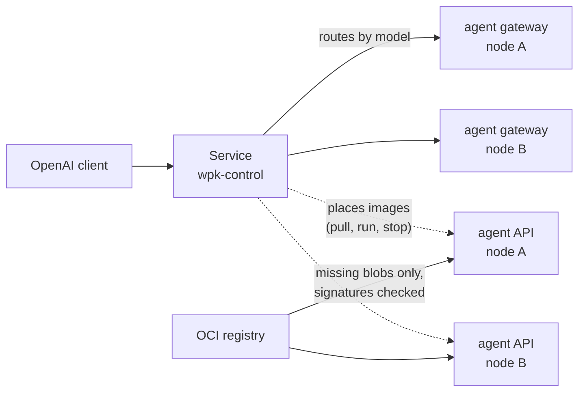

# Weightpack on Kubernetes

The Helm chart in `deploy/helm/weightpack` runs two components:

- **Node agent.** `wpkd` on every GPU node, as a DaemonSet. Its store lives on the node's disk, so base weights survive restarts and upgrades. It pulls images under the trust policy and runs them on vLLM or the reference engine.
- **Control plane.** `wpk-control`, a Deployment behind a Service. It is the cluster's OpenAI-compatible endpoint, and keeps the catalogue's images running on the agents.



## Install

```bash
helm install weightpack deploy/helm/weightpack -n weightpack --create-namespace -f my-values.yaml
```

A minimal `my-values.yaml` for NVIDIA nodes (the GPU device plugin must be installed):

```yaml
agent:
  variant: cuda          # vLLM; "cpu" runs the reference engine on CPU
  gpus: 1
  maxEngines: 1
  nodeSelector:
    nvidia.com/gpu.present: "true"
  registrySecret: registry-creds    # a kubernetes.io/dockerconfigjson Secret, if the registry needs a login

auth:
  apiKey: change-me      # clients send Authorization: Bearer change-me

catalogue:
  models:
    - name: qwen-tasks
      image: ghcr.io/acme/qwen-tasks:v1
      replicas: 2
    - name: support
      image: ghcr.io/acme/support:v3   # replicas 0: started on its first request

trust:
  rules:
    - scope: ghcr.io/acme
      action: signed
      identities:
        - subject_regexp: https://github.com/acme/models/\.github/workflows/release\.yml@refs/tags/.*
          issuer: https://token.actions.githubusercontent.com
    - scope: "*"
      action: reject
```

Then, from inside the cluster, `http://weightpack.weightpack.svc.cluster.local/v1` is the OpenAI endpoint: the model `qwen-tasks/sql` reaches the `sql` expert of `qwen-tasks`, as with `wpk run` on one machine. From your machine:

```bash
kubectl -n weightpack port-forward svc/weightpack 8080:80
curl http://127.0.0.1:8080/v1/chat/completions -H "Authorization: Bearer change-me" \
  -H 'Content-Type: application/json' \
  -d '{"model": "qwen-tasks/sql", "messages": [{"role": "user", "content": "Count the orders per customer."}]}'
```

## How images are placed

The control plane keeps no state of its own. Every few seconds (`control.interval`) it makes a pass:

1. **Find the agents.** It looks up the agents' headless Service in DNS: one address per ready pod. It needs no Kubernetes API access.
2. **Read each agent.** Its node, engines and engine cap, the containers it runs (with their serving base) and the images in its store.
3. **Reread the catalogue** from its ConfigMap.
4. **Move each model one step toward its replicas.** It clears exited containers, adds a replica, replaces one that runs an old digest, or stops one too many. It also stops the containers it started for models no longer in the catalogue. It never touches containers it did not start.

Placing a replica follows the design's base-affinity rule, in this order:

1. A node whose engine already serves the image's serving base. Only the image's adapters load, in seconds.
2. A node whose store holds the image.
3. A node whose store holds its base layer, so most of the download is saved.
4. The node running the fewest engines.

A node at `agent.maxEngines` takes only images on a base it already serves. Before placing, the control plane asks an agent to resolve the image under its trust policy. An image the nodes would refuse is never placed, and the refusal shows in `/v1/cluster`.

Requests go to the node serving the model with the fewest requests in flight. If a node stops answering, its requests move to another replica. A model with `replicas: 0` starts on its first request, which waits for it, and then keeps running. Moving the image's tag (or changing `image`) replaces the replicas one at a time, so a model with two or more replicas keeps serving.

## Operating it

- **`GET /v1/cluster`** (on the control plane, with the API key) shows every agent, its node, engines and containers, and per model the nodes serving it and the last placement error.
- **`GET /metrics`** exports Prometheus metrics: agents found and up, replicas per model, requests in flight per node, requests by model and status, request time, and placements by result.
- **`wpk` on a node.** `kubectl exec ds/weightpack-agent -- wpk ps`, `wpk logs`, `wpk doctor` work as on one machine.
- **Keys.** The chart generates `agent-key`, which the control plane uses for the agents' API (`wpkd --api`) and gateways, and keeps it across upgrades. A NetworkPolicy lets only the control plane reach those ports; it needs a CNI that enforces policies.
- **Trust policy.** It is mounted from the ConfigMap, so `wpk trust set` on a node fails; change `trust.rules` and upgrade instead. Agents reread it on every pull.
- **One control plane replica.** Replicas do not coordinate yet, so two could place the same model twice; the extra one is stopped on the next pass when the model has a fixed replica count.

## Images

The release publishes `ghcr.io/rizkaitbrik/weightpack:<version>-cuda`, `-cpu` and `-control`. To build them from a checkout:

```bash
docker build -f docker/Dockerfile --target cuda    -t weightpack:dev-cuda .
docker build -f docker/Dockerfile --target cpu     -t weightpack:dev-cpu .
docker build -f docker/Dockerfile --target control -t weightpack:dev-control .
helm install weightpack deploy/helm/weightpack --set image.repository=weightpack --set image.tag=dev
```
